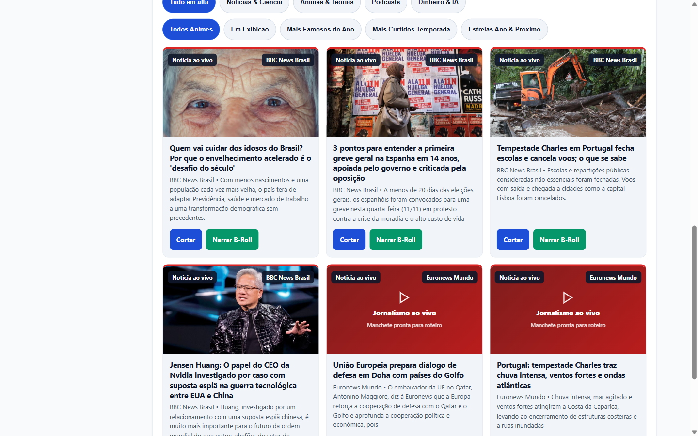
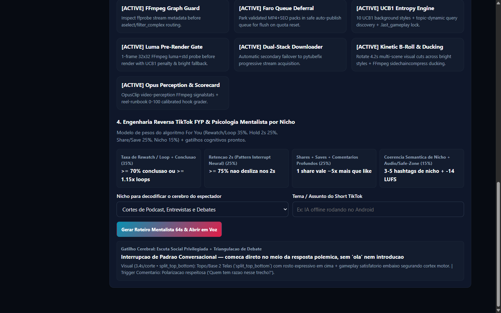
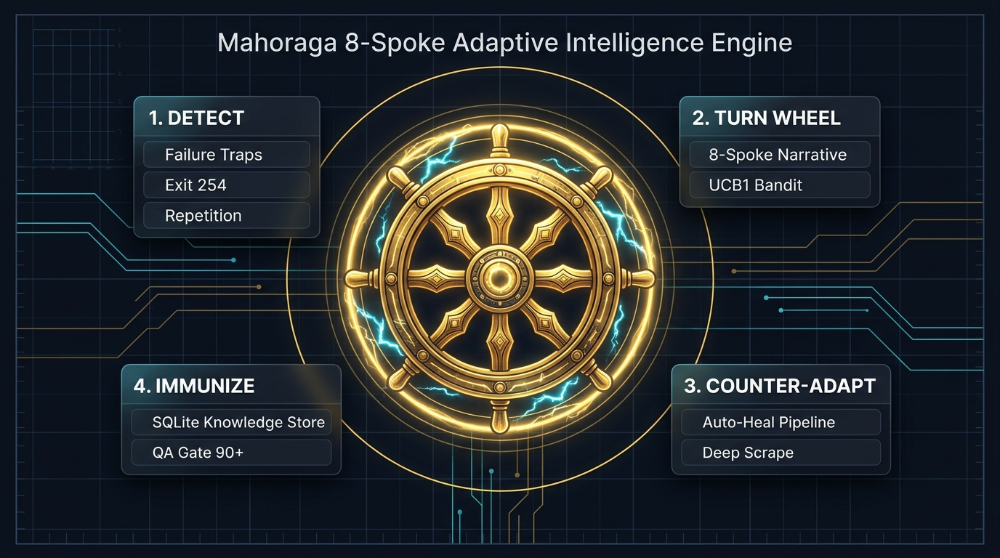

<div align="center">


<h1>AutoShorts Android Studio</h1>

<p>
  <strong>Autonomous Multi-Niche 9:16 Vertical Video Factory engineered for Android (<code>Termux aarch64</code>) &amp; Windows Desktop</strong><br/>
  <em>Mahoraga 8-Spoke Adaptive Intelligence · Zero PyTorch/Docker Bloat · Offline Edge-LLM + BM25 RAG · Kokoro-82M PT-BR &amp; Open-Swara Voices · Multi-Scene B-Roll · Opus 5D QA</em>
</p>

<p>
  <a href="https://github.com/ManoAlee/auto-shorts-android/actions/workflows/ci.yml"></a>
  <a href="pyproject.toml"></a>
  <a href="scripts/install_termux.sh"></a>
  <a href="#verification--testing"></a>
  <a href="#mahoraga-8-spoke-adaptive-intelligence"></a>
  <a href="LICENSE"></a>
</p>

<p>
  <a href="#-live-studio-preview">Studio Preview</a> •
  <a href="#-mahoraga-8-spoke-adaptive-intelligence">Mahoraga Engine</a> •
  <a href="#-system-architecture">Architecture</a> •
  <a href="#-multi-niche--voice-pipeline">Voice &amp; B-Roll</a> •
  <a href="#-quick-start">Quick Start</a> •
  <a href="#-http--openai-compatible-api-8787">API Reference</a>
</p>

</div>

---

## Live Studio Preview

AutoShorts ships with a zero-dependency, real-time Web Studio (`:8787`) optimized for both **desktop monitors** and **mobile Android screens** — featuring live 5-stage render tracking, TikTok Creator Rewards (`60s–180s`) + YouTube Shorts publishing queues, UCB1 B-Roll bandit telemetry, and an accessible `<dialog>` inspector.

<table>
  <tr>
    <td width="64%" align="center">
      <br/>
      <sub><b>Desktop Studio Dark (<code>:8787</code>)</b> — Modular sidebar rail, UCB1 B-Roll KPIs, Framing Tiles &amp; interactive 9:16 simulator</sub>
    </td>
    <td width="36%" align="center">
      <br/>
      <sub><b>Android Mobile View (<code>390x844</code>)</b> — Zero horizontal overflow &amp; thumb-friendly bottom navigation</sub>
    </td>
  </tr>
  <tr>
    <td width="50%" align="center">
      <br/>
      <sub><b>High-Contrast Light Mode</b> — Editorial monochrome surface with live queue &amp; Opus Scorecard badges</sub>
    </td>
    <td width="50%" align="center">
      <br/>
      <sub><b>TikTok Creator Rewards &amp; Synapse RE</b> — 60s–180s monetization scoring, multi-account dispatch &amp; 5D QA</sub>
    </td>
  </tr>
  <tr>
    <td colspan="2" align="center">
      <br/>
      <sub><b>Live 5-Stage Render Stepper</b> — Real-time progress across <code>1. Coleta</code> → <code>2. Voz/Legenda</code> → <code>3. B-Roll/FFmpeg</code> → <code>4. Visão/Opus</code> → <code>5. TikTok/YT</code></sub>
    </td>
  </tr>
</table>

---

## Mahoraga 8-Spoke Adaptive Intelligence

> *"Every failure, repetition, FFmpeg filter error, or empty feed turns the Wheel, counter-adapts immediately, and permanently immunizes the pipeline in SQLite."*

<div align="center">
  
  <br/>
  <sub><b>Mahoraga Adaptive Loop (<code>src/auto_shorts/mahoraga.py</code>)</b> — Detect → Turn 8-Spoke Wheel → Counter-Adapt → Immunize in <code>shorts_evolution.db</code></sub>
</div>

<br/>

| Immunity Code | Phenomenon Detected | Counter-Adaptation Applied | Module |
| :--- | :--- | :--- | :--- |
| **`IMMUNITY_SPEECH_8SPOKE`** | Repetitive/robotic single-template scripts across videos | Rotates 8 distinct narrative Spokes in SQLite (`mahoraga_speech_ledger`) + strips duplicate title/summary echoes | [`mahoraga.py`](src/auto_shorts/mahoraga.py), [`world_news.py`](src/auto_shorts/world_news.py), [`story_engine.py`](src/auto_shorts/story_engine.py) |
| **`IMMUNITY_HOOK_WORD_BOUNDARY`** | Sliced hooks (`"SOBRE O S"`) or dangling verbs (`"POR QUE ESCREVER SOFTWARE"`) | Strips conversational lead-ins and snaps strictly on complete clause/word boundaries (`"SOFTWARE CORRETO É DIFÍCIL"`) | [`mahoraga.py`](src/auto_shorts/mahoraga.py), [`renderer.py`](src/auto_shorts/renderer.py) |
| **`IMMUNITY_VISUAL_NICHE_SHIELD`** | Gaming/Minecraft parkour leaking into Anime, Tech, Finance, or News | Blocks `_BRAINROT_GAMEPLAY_STYLES` outside `niche="gameplay"` and enforces multi-scene cinematic B-roll | [`gameplay.py`](src/auto_shorts/gameplay.py), [`narrator.py`](src/auto_shorts/narrator.py) |
| **`IMMUNITY_FFMPEG_3STAGE_HEAL`** | FFmpeg `exit 254` filtergraph / `punch_zoom` / overlay failures | Isolated `_work_<tag>` dirs + automatic 3-stage fallback (`libx264` static scale → clean `blur_bg`) logged to SQLite | [`renderer.py`](src/auto_shorts/renderer.py), [`pipeline.py`](src/auto_shorts/pipeline.py) |
| **`IMMUNITY_TIKTOK_REWARDS_180S`** | 60s YouTube Shorts cap falsely rejecting 60–180s TikTok Creator Rewards clips | Platform-aware validator (`180s` for `tiktok_rewards`), plus Opus 5D & YT/TT algorithm scoring calibration | [`validator.py`](src/auto_shorts/validator.py), [`re_engine.py`](src/auto_shorts/re_engine.py) |
| **`IMMUNITY_DEEP_ARTICLE_EXTRACTOR`** | Bare title-only feeds (e.g., Hacker News where `summary == title`) | Scrapes `<meta og:description>`, `og:image`, and article `<p>` paragraphs or builds domain-specific analysis | [`world_news.py`](src/auto_shorts/world_news.py), [`horizon_radar.py`](src/auto_shorts/horizon_radar.py) |

---

## System Architecture

```mermaid
flowchart LR
  subgraph Discovery["1. Multi-Source Discovery"]
    HR["Horizon Radar\n(Podcasts, Tech/IA, Finanças)"]
    AN["AniList / Jikan\n(4 Anime Feeds)"]
    WN["World News RSS + Scraper\n(Auto PT-BR + og:image)"]
    YT["YouTube InnerTube\n(Most Replayed Heatmaps)"]
  end

  subgraph Intelligence["2. Mahoraga & Edge-LLM"]
    MAH["Mahoraga 8-Spoke Wheel\n(Anti-Repetition + Auto-Heal)"]
    LLM["OpenRouter / Gemini /\nllama-cli GGUF (--single-turn)"]
    BM25["BM25 Local RAG\n+ Hook Word-Boundary Guard"]
  end

  subgraph Production["3. Audio & 9:16 Video Pipeline"]
    TTS["Kokoro-82M PT-BR / Edge-TTS /\nCosyVoice + Open-Swara WAVs\n(Warm Broadcast EQ + Trim)"]
    BR["UCB1 Multi-Scene B-Roll\n(~4.2s switches + -16 LUFS)"]
    SUB["Progressive \\kf Karaoke\n(.ass + Whisper / WordBoundary)"]
  end

  subgraph QA["4. Quality Gate & Delivery"]
    AUD["5-Frame Vision & Signalstats\n+ Opus Scorecard (0-100)"]
    DEDUP["Duplicate Guard + 180s TikTok\n+ Auto-Optimize Metadata"]
    PUB["TikTok Rewards API\nYouTube Data API v3 / Reels"]
  end

  Discovery --> Intelligence --> Production --> QA
```



---

## Multi-Niche & Voice Pipeline

| Layer | Capabilities & Optimizations | Source Modules |
| :--- | :--- | :--- |
| **8-Spoke Universal Niches** | Finance & Business, AI & Tech, World News, Psychology & Biohacking, Podcasts & Debates, Anime & Pop Culture, Science, and Gaming — with automatic niche rotation in 24/7 Autopilot | [`config.py`](src/auto_shorts/config.py), [`horizon_radar.py`](src/auto_shorts/horizon_radar.py), [`story_engine.py`](src/auto_shorts/story_engine.py) |
| **Humanized PT-BR Voice** | Spoken normalization (`R$`, `%`, `IA`, `EUA`, `STF`, `km/h`), broadcast warmth EQ + de-esser, **Kokoro-82M PT-BR offline ONNX** + Edge-TTS + CosyVoice/F5-TTS/GPT-SoVITS failover with CC-BY-SA Open-Swara reference WAVs | [`narrator.py`](src/auto_shorts/narrator.py), [`assets/voices/`](assets/voices/) |
| **Offline Edge-LLM & BM25** | ARM64 SoC ISA probing (`dotprod`/`asimddp`, `fp16`, `i8mm`, `sve`), RAM-tiered GGUF catalog, `<think>`/`<thought>` CoT stripping, pure-Python BM25 local RAG, `/v1/chat/completions`, `/api/ai/benchmark` | [`offline_llm.py`](src/auto_shorts/offline_llm.py), [`highlights.py`](src/auto_shorts/highlights.py) |
| **9:16 Video & UCB1 B-Roll** | `blur_bg`, `split_top_bottom`, facial-tracked `center_crop`, dynamic `~4.2s` multi-scene B-roll + UCB1 evolution bandit, `-16 LUFS` loudnorm & sidechain ducking | [`renderer.py`](src/auto_shorts/renderer.py), [`gameplay.py`](src/auto_shorts/gameplay.py), [`evolution.py`](src/auto_shorts/evolution.py) |
| **QA & Multi-Platform Gate** | `ffprobe` & `ffmpeg signalstats` luminance/motion/freeze checks, 5D Opus Scorecard (`0–100`), subtitle coverage checks, duplicate queue guard, TikTok Creator Rewards (`60–180s`) & YouTube Shorts (`<=60s`) | [`validator.py`](src/auto_shorts/validator.py), [`re_engine.py`](src/auto_shorts/re_engine.py), [`smart_autopublish.py`](src/auto_shorts/smart_autopublish.py) |
| **Native C11 & C# Desktop** | C11 daemon watchdog (`autoshorts`) & zero-exec MP4 container auditor (`media_audit`); Windows `.NET WinForms` companion (`IDisposable` safe HTTP/FFmpeg + Opus inspector) | [`native-c/`](native-c/), [`desktop-cs/AutoShortsDesktop.cs`](desktop-cs/AutoShortsDesktop.cs) |

---

## Quick Start

### 1. Android (`Termux aarch64`)

```bash
git clone https://github.com/ManoAlee/auto-shorts-android.git
cd auto-shorts-android
cp .env.example .env

# Install core Termux runtime (python, ffmpeg, yt-dlp, termux-api, optional whisper.cpp)
bash scripts/install_termux.sh

# Optional: install offline Kokoro-82M PT-BR StyleTTS2 engine
bash scripts/install_kokoro_ptbr.sh

# Start Web Studio (:8787) + C11 background watchdog
bash scripts/start_webapp.sh 8787
```

### 2. Local CLI / Windows Desktop

```bash
# Autonomous 9:16 cut for TikTok Creator Rewards (60s-180s) or YouTube Shorts
python main.py "https://www.youtube.com/watch?v=VIDEO_ID" --niche podcast --platform tiktok_rewards --layout blur_bg

# Launch Web Studio on localhost:8787
python main.py --serve --port 8787
```

### 3. Windows C# Desktop Companion (Optional)

```powershell
C:\Windows\Microsoft.NET\Framework64\v4.0.30319\csc.exe /nologo /target:winexe /out:desktop-cs\AutoShortsDesktop.exe /reference:System.Web.Extensions.dll desktop-cs\AutoShortsDesktop.cs
```

---

## HTTP & OpenAI-Compatible API (`:8787`)

| Method & Endpoint | Purpose |
| :--- | :--- |
| `GET /` | Modular Studio Web UI (`Cache-Control: no-store`) |
| `GET /api/status` | Live 5-stage render progress (`stage_index`, `progress_pct`, `elapsed_sec`) + live **Mahoraga** wheel telemetry |
| `GET /api/mahoraga` | Full Mahoraga 8-Spoke status, active spoke, 6 active immunities & SQLite adaptation log |
| `GET /api/videos?status=...&q=...` | Paginated library (`all`, `approved`, `queued`, `published`, `tiktok_ready`, `tiktok_sent`) with Opus 5D & visual audit |
| `GET /api/horizon?topic=todos` | Multi-niche trend feed with background warm cache |
| `POST /api/run` | Enqueue YouTube clip discovery or URL cutting (`9:16`) |
| `POST /api/narrate` | Enqueue Kokoro PT-BR + Multi-Scene B-Roll narration render |
| `POST /api/auto-validate-all` | End-to-end validation, PT-BR healing, hook sanitization, dedup & smart upload queue dispatch |
| `GET /v1/models`, `POST /v1/chat/completions` | OpenAI-compatible offline ARM64/BM25 RAG assistant endpoint |
| `POST /api/ai/chat`, `POST /api/ai/benchmark` | Studio AI Copilot & ARM64 GGUF inference benchmark |

---

## Repository Structure

```text
auto-shorts-android/
├── .github/                  # GitHub Actions CI, CODEOWNERS, PR & Issue templates
├── assets/voices/            # CC-BY-SA Open-Swara PT-BR voice reference WAVs
├── desktop-cs/               # C# .NET Framework WinForms companion app
├── docs/                     # Architecture guides, benchmarks & Studio screenshots
│   └── images/               # Studio previews, Mahoraga diagram & vector banner
├── native-c/                 # C11 Termux watchdog & fast MP4 container auditor
├── scripts/                  # Termux installers, Kokoro setup & daemon launchers
├── src/auto_shorts/          # Core Python package (mahoraga, narrator, renderer, etc.)
│   └── frontend/             # Modular HTML/CSS/JS Studio UI
├── tests/                    # Automated pytest suite
├── main.py                   # CLI & Studio entrypoint
├── mcp_server.py             # MCP bridge server
└── pyproject.toml            # Packaging, pytest & ruff configuration
```

---

## Documentation

- [Arquitetura Completa e Guia de Produção](docs/ARQUITETURA_E_PRODUCAO.md)
- [Estudo de Engenharia Reversa](docs/ESTUDO_ENGENHARIA_REVERSA.md)
- [Modelos de IA Local no Android](docs/ESTUDO_MODELOS_IA_LOCAL_ANDROID.md)
- [Nichos, Retenção e Monetização no Brasil](docs/ESTUDO_NICHOS_MONETIZACAO_BRASIL.md)
- [Entrega, Portais e Evolução](docs/ESTUDO_ENTREGA_PORTAIS_E_EVOLUCAO.md)
- [Ferramentas Open-Source de Referência](docs/FERRAMENTAS_GITHUB_OPENSOURCE.md)

---

## Verification & Testing

```bash
# Run full Python test suite
python -m pytest tests -q

# Validate frontend JavaScript syntax
node --check src/auto_shorts/frontend/studio.js
```

## Contributing & Security

- Contributions welcome — see [CONTRIBUTING.md](CONTRIBUTING.md) and [CHANGELOG.md](CHANGELOG.md).
- Vulnerability reporting and hardening guidelines live in [SECURITY.md](SECURITY.md).
- Released under the [MIT License](LICENSE).
