<div align="center">


[](https://github.com/ManoAlee/auto-shorts-android/actions/workflows/ci.yml)
[](pyproject.toml)
[](scripts/install_termux.sh)
[](src/auto_shorts/publisher.py)
[](#verification--testing)
[](LICENSE)

**Fábrica Autônoma de Vídeos Verticais 9:16 para TikTok, YouTube Shorts & Reels — rodando direto no Android (`Termux aarch64`) e Windows Desktop**  
*Zero PyTorch/Docker · Edge-LLM + BM25 Offline RAG · Vozes Kokoro-82M PT-BR & Open-Swara · Neuro-Mentalismo TikTok FYP · Multi-Cena B-Roll UCB1 · Retenção Inteligente de Armazenamento*

</div>

---

## Preview Visual do Studio (`OLED Midnight` + `Editorial Light` + Mobile)

<table>
  <tr>
    <td width="66%" align="center">
      <br/>
      <sub><b>Desktop Studio OLED (`:8787`)</b> — Copiloto IA com sugestão contextual em 1 clique, barra 5 estágios ao vivo, seletor multi-plataforma (TikTok/YouTube/Reels) e simulador 9:16</sub>
    </td>
    <td width="34%" align="center">
      <br/>
      <sub><b>Mobile Android (`390×844`)</b> — Zero overflow horizontal, alvos tácteis WCAG >= 44px e barra inferior nativa</sub>
    </td>
  </tr>
  <tr>
    <td align="center">
      <br/>
      <sub><b>Acervo &amp; Publicação Multi-Canal</b> — Player 9:16, Opus Runbook Scorecard (0–100), status TikTok/YouTube e disparo rápido</sub>
    </td>
    <td align="center">
      <br/>
      <sub><b>Synapse RE + Mentalismo TikTok FYP</b> — Pesos do algoritmo For You (Loop 35%, 2s Hold 25%, Share/Save 25%, Nicho 15%) e roteirizador cognitivo</sub>
    </td>
  </tr>
  <tr>
    <td colspan="2" align="center">
      <br/>
      <sub><b>Tema Claro Editorial (alternância 1-clique no topo)</b> — Radar Multi-Horizonte (Em Alta, Animes 4 Frentes e Notícias BR em PT-BR)</sub>
    </td>
  </tr>
</table>

---

## Como Foi Pensado & Lógica do Motor

O **AutoShorts Android** foi arquitetado a partir de um problema real: pipelines comuns de IA em vídeo exigem GPU na nuvem, Docker pesado e vários gigabytes de PyTorch — inviável em um celular Android comum. A solução substitui peso bruto por **engenharia determinística em Python + C11 + FFmpeg + modelos ONNX/GGUF quantizados**, dividida em **5 pilares cognitivos e técnicos**:

### 1. Por que rodar direto no Android Termux (`~7–8 GB RAM`) sem Docker/PyTorch
- **Supervisor Nativo em C11 (`native-c/`)**: `autoshorts` mantém o servidor `:8787` vivo mesmo após hibernação do Android, enquanto `media_audit` inspeciona containers MP4/ISO-BMFF em microssegundos sem subir processos Python pesados.
- **Inferência Sob Demanda (`offline_llm.py`)**: detecta as instruções ARMv8 do processador (`asimddp` / `dotprod`, `fp16`, `i8mm`, `sve`) e roda `llama-cli --single-turn` em GGUF Q4_K_M apenas durante a síntese de roteiro, liberando ~1 GB de RAM assim que termina e removendo tags internas `<think>`/`<thought>` via `strip_reasoning_tags`. Caso a nuvem (`openrouter/free` / Gemini) esteja offline, um motor **BM25 lexical local** + heurísticas mantêm a fila operante 100% offline.

### 2. Engenharia Reversa Multi-Algoritmo (TikTok FYP + YouTube Shorts)
Em vez de gerar vídeos genéricos e torcer por cliques, o motor separa **dois algoritmos distintos** em [`tiktok_algorithm.py`](src/auto_shorts/tiktok_algorithm.py) e [`yt_algorithm.py`](src/auto_shorts/yt_algorithm.py):

| Plataforma | Fator Dominante na Coorte | Janela de Ouro | Regra no Motor |
| :--- | :--- | :--- | :--- |
| **TikTok FYP (`tiktok_rewards`)** | **35% Rewatch/Loop + Conclusão**<br>**25% Retenção 2s (Pattern Interrupt)**<br>**25% Shares + Saves + Comentários**<br>**15% Coerência de Nicho (`3–5` tags)** | `15–32s` (viral sprint) ou **`62–75s`** (monetização *Creator Rewards*) | Última frase sintaticamente conectada à primeira para forçar loop; rejeita tags spam (`#fyp`, `#viral`); respeita Safe-Zone visual para ícones laterais |
| **YouTube Shorts (`youtube_shorts`)** | **Viewed vs. Swiped-Away (`>=75%`)** + curvas **InnerTube Most Replayed** | `34–55s` (`< 60s` para feed máximo e menor risco Content ID) | Captura picos reais de replay via `ytInitialData` / Android InnerTube; título mobile front-loaded em `<=40` chars + playlists segmentadas |

### 3. Psicologia Mentalista & Córtex Visual por Nicho (`tiktok_algorithm.py`)
Cada um dos 9 nichos (`financas`, `ia_tech`, `entretenimento_animes`, `desenvolvimento_pessoal`, `saude_fitness`, `podcast`, `concursos`, `noticias_mundiais`, `geral`) possui um **Playbook Mentalista** dedicado que guia tanto o prompt do LLM quanto os roteiros em 3/4 atos (`team.py`):
- **0–2s (Interrupção de Padrão Neural):** contradição direta, perda invisível (*Finanças*), detalhe oculto no frame (*Animes*), ou *Cold Reading / Efeito Barnum* na 2ª pessoa (*Desenvolvimento Pessoal*) — trava o polegar antes do swipe reflexivo.
- **Reflexo de Orientação Visual (`2.6s–4.2s` por corte):** o cérebro humano reativa atenção a cada nova variação de estímulo luminoso; por isso o motor alterna clipes de B-Roll claro + legendas karaoke `\\kf` de 3 palavras sem nunca esconder o centro facial.
- **Gatilho de Comentário + Ponte Circular de Loop:** o fechamento evita despedidas lentas (*"até o próximo vídeo"*) que derrubam retenção nos 5 segundos finais, emendando uma pergunta polarizadora e uma ponte gramatical de volta para os primeiros 2 segundos.

### 4. Bandit Evolucionário UCB1 + Portão Anti-Defeito (Opus 5D & FFmpeg Vision)
- **`evolution.py` (Upper Confidence Bound — UCB1)**: trata cada estilo de fundo (`minecraft`, `subway_surfers`, `drone_cinema`, `urban_rain`, etc.) como um braço em aprendizado por reforço. Estilos que geram vídeos com nota mais alta no auditor vencem mais rodadas, mantendo exploração controlada com `.last_gameplay` para nunca repetir dois seguidos.
- **Portão Anti-Tela-Preta & Legenda Zero (`validator.py` + `re_engine.py`)**: antes do upload, o sistema extrai 5 frames ao longo do MP4 e valida `motion_delta >= 1.8`, `luma_mean >= 20`, presença real de voz (`-14 LUFS`), e penaliza qualquer corte com `subtitle_cues == 0` no **Opus Runbook Scorecard (0–100)**.
- **Voz Humanizada PT-BR (`narrator.py`)**: normaliza siglas e símbolos antes da fala (`R$ 150,50` → *"cento e cinquenta reais e cinquenta centavos"*, `IA`, `%`, `km/h`), aplica EQ de calor vocal e comprime trilha musical por **sidechain ducking**.

### 5. Piloto 24/7 Dual-Channel & Retenção Inteligente de Espaço (`retention.py`)
O agendador autônomo (`_autonomous_loop` + `_auto_crosspost_channels` em `webapp.py`):
1. Gera e valida novos Shorts em rotação multi-nicho;
2. Envia automaticamente para **TikTok (`Content Posting API v2` via Inbox Draft ou Direct Post + PKCE SHA-256 hex + chunks floor `<= 64 MB`)** e para **YouTube Data API v3**;
3. Se o YouTube atingir o limite diário (`uploadLimitExceeded`), estaciona o pacote na fila (`queued_for_auto_publish: true`) e drena automaticamente nas próximas janelas sem perder nada;
4. Executa **`prune_storage()`** para remover diretórios temporários `_work_*`/`_narrate_*`, duplicatas semânticas e vídeos antigos **já publicados**, mantendo os ainda não postados intactos e o celular sempre dentro da cota (`STORAGE_MAX_VIDEOS=20`, `STORAGE_MAX_MB=1200`).

---

## Arquitetura do Pipeline

```mermaid
flowchart LR
  subgraph Discovery["1. Descoberta Multi-Horizonte"]
    HR["Horizon Radar\n(Podcasts, Tech/IA, Finanças)"]
    AN["AniList / Jikan\n(4 Frentes Anime)"]
    WN["World News RSS\n(Auto PT-BR)"]
    YT["YouTube InnerTube\n(Heatmaps Most Replayed)"]
  end

  subgraph Brain["2. IA, Mentalismo & Higiene"]
    MENT["Playbooks TikTok FYP\n(Loop 35% + Cold Read 2s)"]
    LLM["OpenRouter / Gemini /\nllama-cli GGUF (--single-turn)"]
    BM25["BM25 Local RAG\n+ Escudo CoT <think>"]
  end

  subgraph Media["3. Voz PT-BR & Vídeo 9:16"]
    TTS["Kokoro-82M PT-BR / Edge-TTS /\nCosyVoice + Open-Swara WAVs"]
    BR["UCB1 Multi-Cena B-Roll\n(Cortes ~3.5s + Sidechain -14 LUFS)"]
    SUB["Karaoke \\kf 3 Palavras\n(Whisper / WordBoundary)"]
  end

  subgraph Delivery["4. Portão QA, Retenção & Dual-Publish"]
    AUD["Visão 5-Frames FFmpeg\n+ Opus 5D + TikTok Score"]
    RET["Smart Retention Prune\n(Preserva fila não postada)"]
    PUB["TikTok API v2 (Inbox/Direct)\n+ YouTube Data API v3 + Reels"]
  end

  Discovery --> Brain --> Media --> Delivery
```



---

## Quick Start

### 1. Android (`Termux aarch64`)

```bash
git clone https://github.com/ManoAlee/auto-shorts-android.git
cd auto-shorts-android
cp .env.example .env

# Instala runtime core no Termux (python, ffmpeg, yt-dlp, termux-api, whisper opcional)
bash scripts/install_termux.sh

# Opcional: instala Kokoro-82M PT-BR StyleTTS2 offline
bash scripts/install_kokoro_ptbr.sh

# Autoriza YouTube Data API v3 e/ou TikTok Content Posting API v2 (PKCE SHA-256 hex)
python scripts/youtube_auth.py --no-browser
python scripts/tiktok_auth.py --no-browser

# Sobe o Web Studio (:8787) + watchdog C11 em segundo plano
bash scripts/start_webapp.sh 8787
```

### 2. Local CLI / Windows Desktop

```bash
# Corte autônomo 9:16 adaptado para TikTok Rewards (62s+) ou YouTube Shorts
python main.py "https://www.youtube.com/watch?v=VIDEO_ID" --niche podcast --platform tiktok_rewards --layout blur_bg

# Abre o Studio Web em http://127.0.0.1:8787
python main.py --serve --port 8787
```

---

## API HTTP & OpenAI-Compatible (`:8787`)

- `GET /` — Web Studio UI responsiva (`OLED Midnight` + `Editorial Light`, `Cache-Control: no-store`)
- `GET /api/status` — Telemetria em tempo real dos 5 estágios de renderização e fila
- `GET /api/channel` — Status consolidado YouTube, TikTok (`tiktok_mode`, enviados, pendentes), Voz TTS, UCB1 e IA
- `GET /api/videos?status=all|tiktok_ready|tiktok_sent|approved|queued|published` — Acervo com Opus Scorecard + TikTok FYP Cohort Score
- `GET /api/tiktok/intelligence` & `POST /api/tiktok/mentalist-brief` — Pesos do algoritmo TikTok FYP e gerador mentalista em 4 batidas
- `POST /api/publish` / `POST /api/publish-tiktok` / `POST /api/publish-instagram` — Disparo imediato por vídeo ou lote
- `POST /api/scheduler` — Controle do Piloto 24/7 multi-canal (`enabled`, `platform`, `niche`, `interval_hours`, `run_now`)
- `POST /api/system/prune` — Limpeza inteligente de espaço em disco preservando a fila não publicada
- `GET /v1/models`, `POST /v1/chat/completions`, `POST /api/ai/chat`, `POST /api/ai/benchmark` — Endpoint compatível OpenAI + RAG offline

---

## Verification & Testing

```bash
# Suíte automatizada Python (44 testes passando no Windows, Termux e GitHub Actions CI)
python -m pytest tests -q

# Verificação de sintaxe JS do Studio
node --check src/auto_shorts/frontend/studio.js
```

## Contributing, Legal & Security

- Contribuições são bem-vindas — consulte [CONTRIBUTING.md](CONTRIBUTING.md) e [CHANGELOG.md](CHANGELOG.md).
- Termos, privacidade e política de segurança em [TERMS_OF_SERVICE.md](TERMS_OF_SERVICE.md), [PRIVACY_POLICY.md](PRIVACY_POLICY.md) e [SECURITY.md](SECURITY.md).
- Licenciado sob [MIT License](LICENSE).
