<div align="center">

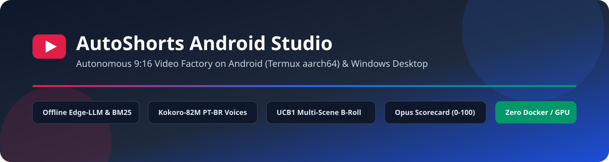

[](https://github.com/ManoAlee/auto-shorts-android/actions/workflows/ci.yml)
[](pyproject.toml)
[](scripts/install_termux.sh)
[](#verification--testing)
[](LICENSE)

**Autonomous 9:16 Vertical Video Factory engineered for Android (`Termux aarch64` + `h264_mediacodec`) & Windows Desktop**  
*Zero PyTorch/Docker bloat · Semantic Topic B-Roll Sniper (`yt-dlp` + Wikimedia 4K) · `blader/humanizer` PT-BR Engine · CapCut SAMI Vocal Mastering & Native Mobile Assets · Opus Scorecard QA*

</div>

---

## Live Studio & Generated 9:16 Shorts (Real Output)

<table>
  <tr>
    <td width="25%" align="center">
      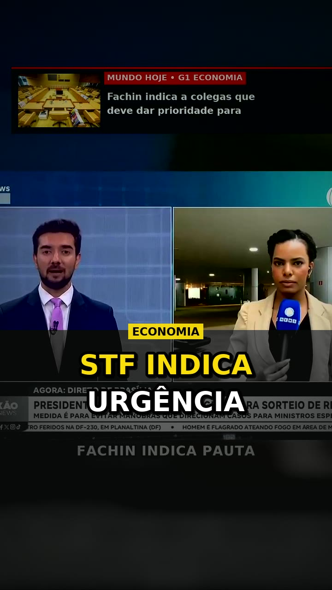<br/>
      <sub><b>Safe-Zone 9:16 (`Y>=140`, `MarginV=300`)</b> — Top news card clear of notch/headers, centered badge, balanced hook &amp; elevated subtitles (<code>90/100</code>)</sub>
    </td>
    <td width="25%" align="center">
      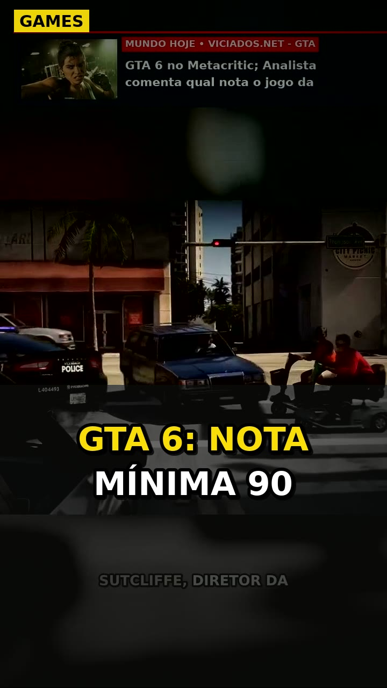<br/>
      <sub><b>Games &amp; Live VODs</b> — Real GTA 6 / streamer VODs up to 8h sliced on-demand via <code>yt-dlp</code> + kinetic captions (<code>90/100</code>)</sub>
    </td>
    <td width="25%" align="center">
      <br/>
      <sub><b>Tech &amp; AI</b> — Tri-layer cinema framing, multi-scene b-roll chaining, progressive <code>\kf</code> karaoke &amp; <code>-16 LUFS</code> voice</sub>
    </td>
    <td width="25%" align="center">
      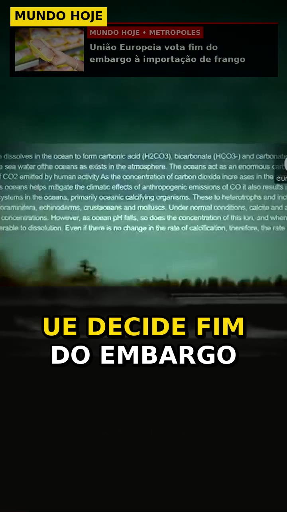<br/>
      <sub><b>World News &amp; Economy</b> — 4-Act journalistic structure, Wikimedia Commons 4K photos, Ken Burns 2.5D &amp; live news card (<code>90/100</code>)</sub>
    </td>
  </tr>
</table>

<table>
  <tr>
    <td width="68%" align="center">
      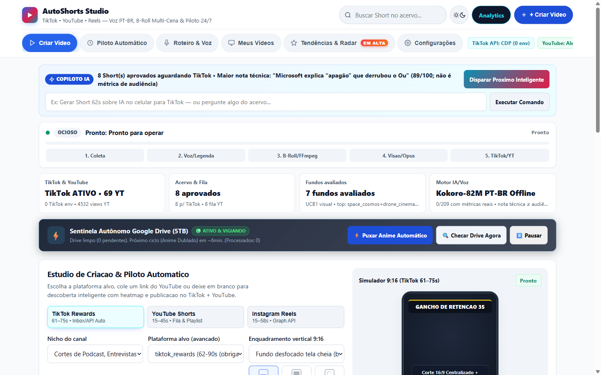<br/>
      <sub><b>Desktop Studio (`1440x900` · `:8787`)</b> — Copiloto IA, 5-stage live render stepper, UCB1 B-Roll KPIs, Sentinela Google Drive &amp; 9:16 creator</sub>
    </td>
    <td width="32%" align="center">
      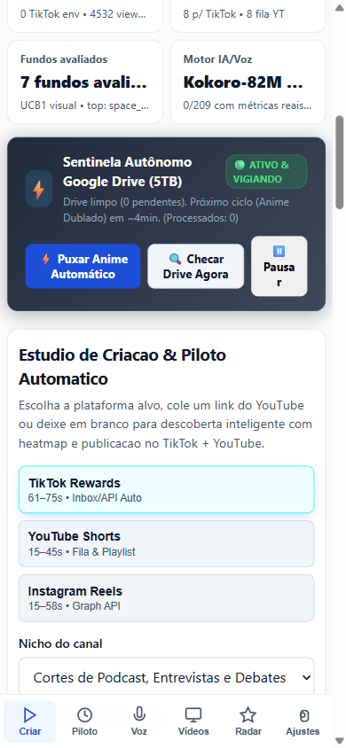<br/>
      <sub><b>Mobile Android View (`390x844`)</b> — Zero horizontal overflow &amp; native bottom navigation</sub>
    </td>
  </tr>
  <tr>
    <td width="68%" align="center">
      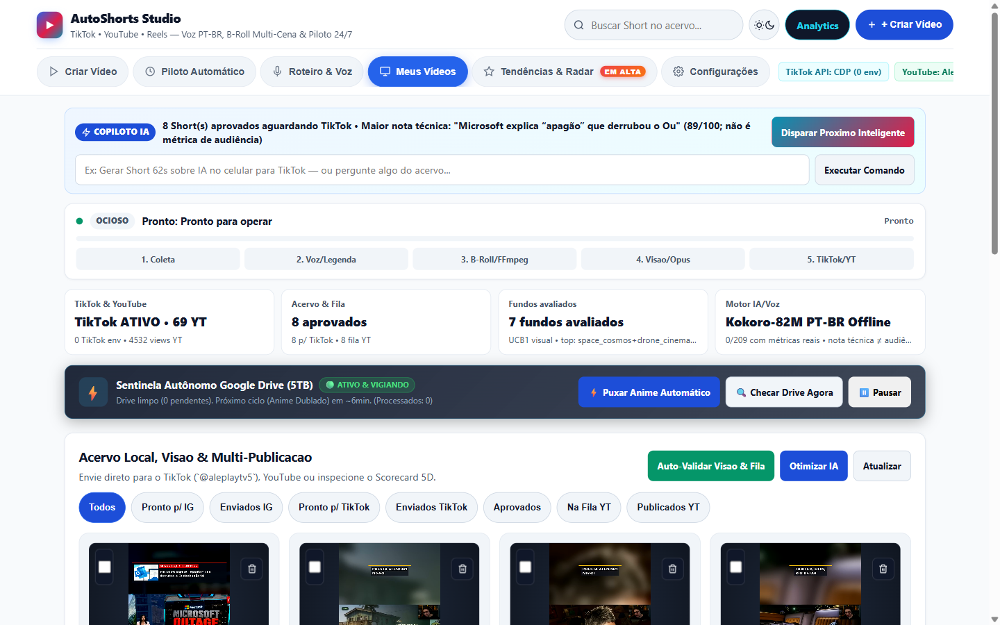<br/>
      <sub><b>Acervo &amp; Canais (Desktop)</b> — Multi-platform status filters (<code>Pronto p/ IG</code>, <code>TikTok</code>, <code>YT</code>), 5D Opus Scorecard &amp; validated 9:16 cards</sub>
    </td>
    <td width="32%" align="center">
      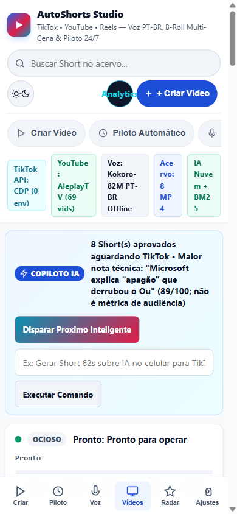<br/>
      <sub><b>Acervo Mobile (`390x844`)</b> — Clean card inspection, one-tap IG/TT/YT publish &amp; quota badges</sub>
    </td>
  </tr>
  <tr>
    <td colspan="2" align="center">
      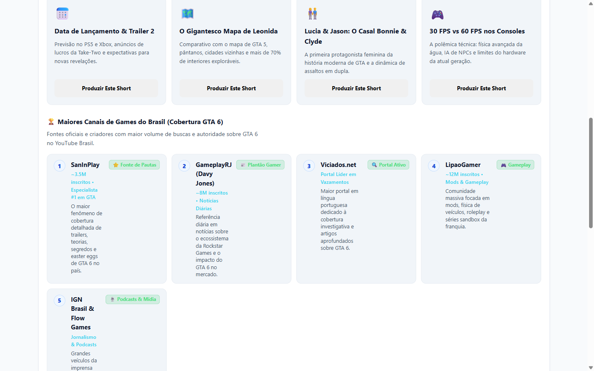<br/>
      <sub><b>Tendências &amp; Radar (`Humor &amp; Memes`, `Games`, `Google Trends BR`)</b> — Live viral topics harvested via <code>bsk</code> + Chromium 157 on Termux</sub>
    </td>
  </tr>
  <tr>
    <td width="50%" align="center">
      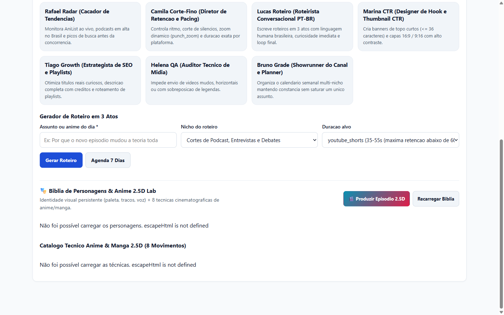<br/>
      <sub><b>Piloto Automático &amp; Mahoraga</b> — 8-Spoke speech rotation, 24/7 Sentinel &amp; organic multi-platform spacing</sub>
    </td>
    <td width="50%" align="center">
      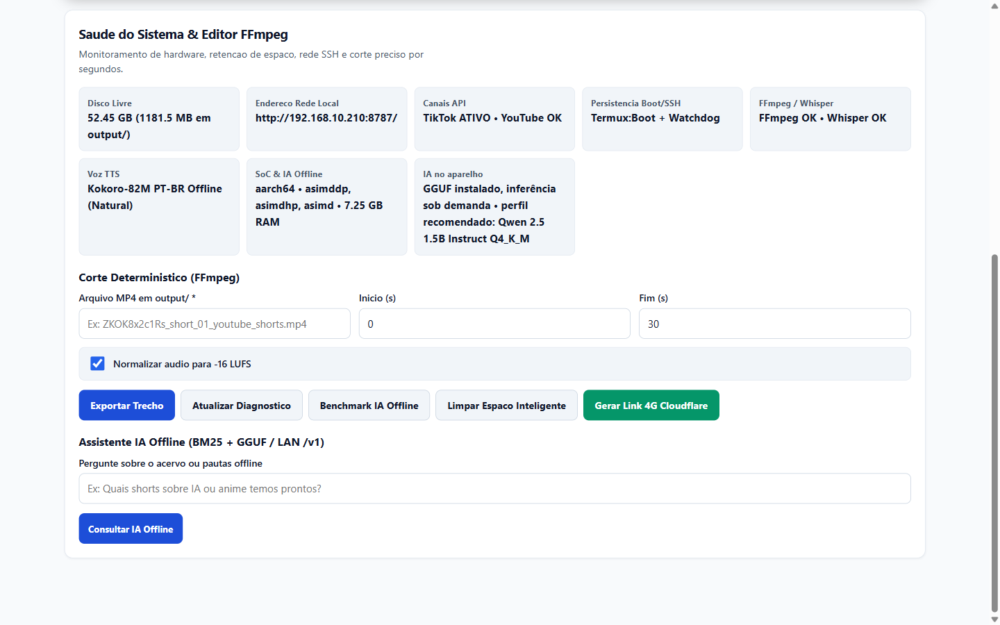<br/>
      <sub><b>Configurações &amp; Sistema</b> — Termux <code>runsv</code> services (<code>autoshorts</code>, <code>autoshorts-web</code>, <code>bsk-browser</code>) &amp; ARM64 telemetry</sub>
    </td>
  </tr>
</table>

---

## System Architecture (Anatomy & Pipeline Flow)

<p align="center">
  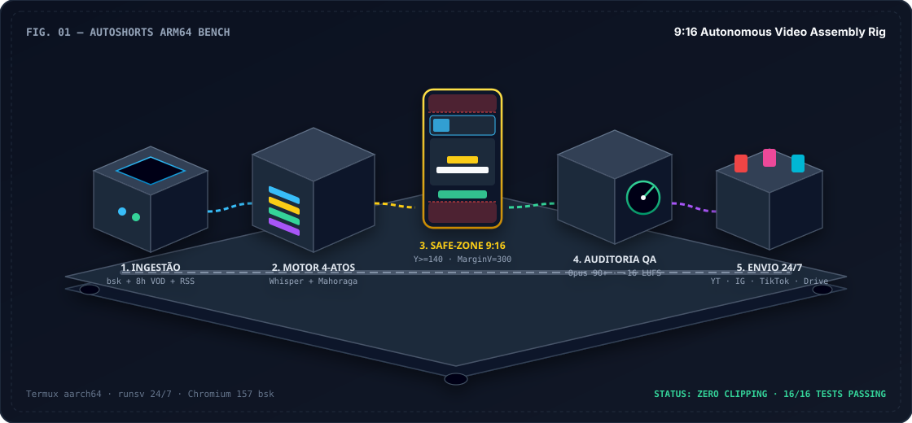
</p>

```mermaid
flowchart LR
  subgraph Discovery["1. Multi-Source Discovery + BrowserSkill"]
    HR["Horizon Radar\n(Podcasts, Humor/Memes, Games)"]
    BSK["BrowserSkill (bsk) + Chromium 157\n(Google Trends BR & Anti-Cloudflare)"]
    WN["World News 8-10p Extractor\n(Auto PT-BR, 4-Act Structure)"]
    VOD["8h Live VOD & Stream Discovery\n(Auto-Scale up to 25 Clips)"]
  end

  subgraph Intelligence["2. Humanizer, Language Probe & Hygiene"]
    LLM["blader/humanizer + LLM\n(De-AI Spoken PT-BR, No Clichés)"]
    LANG["Whisper -dl Audio Lang Probe\n+ '>> ' Marker & Anti-Repetition Guard"]
    BUD["Word-Boundary Hook Guard\n+ Dangling Title Prevention"]
  end

  subgraph Production["3. Semantic Visuals & CapCut SAMI DSP"]
    SEM["Semantic Visual Engine\n(world_news.py + narrator.py\nyt-dlp Sniper + Wikimedia 4K)"]
    SAFE["Universal 9:16 Safe Zones\n(AlbertSans-ExtraBold / TikTokSans-VF)"]
    TTS["Edge-TTS (capcut_julia / cleyton)\n+ SAMI EQ (3.2kHz) & -16 LUFS"]
  end

  subgraph QA["4. Skill Hard-Gate & Auto-Delivery"]
    AUD["5-Frame Vision & Signalstats\n+ Safe-Zone & Hook Audit"]
    DEDUP["SQLite Deduplication Guard\n+ Google Drive rclone Vault"]
    PUB["YouTube Shorts + Instagram Reels\n+ TikTok Organic Autopublish"]
  end

  Discovery --> Intelligence --> Production --> QA
```

---

## Key Capabilities

| Layer | Highlights | Modules |
| :--- | :--- | :--- |
| **Universal Semantic Visual Engine** | Extracts entities from any topic (Games, Animes, Politics, Tech, World News) in both `world_news.py` and `narrator.py` (`build_narrated_short`), snipes real video clips via `yt-dlp --download-sections`, fetches Wikimedia Commons 4K photos, renders 2.5D Ken Burns + `xfade` | [`semantic_visual_engine.py`](src/auto_shorts/semantic_visual_engine.py), [`world_news.py`](src/auto_shorts/world_news.py), [`narrator.py`](src/auto_shorts/narrator.py) |
| **Multi-Lang Whisper & Title Hygiene** | Auto-probes audio language via `whisper-cli -dl`, strips raw `>> ` VTT speaker markers cleanly, enforces `Legendada` vs `Dublada` accuracy, and strips repetition loops in `.ass` cues | [`downloader.py`](src/auto_shorts/downloader.py), [`transcript.py`](src/auto_shorts/transcript.py), [`subtitles.py`](src/auto_shorts/subtitles.py), [`highlights.py`](src/auto_shorts/highlights.py) |
| **Web Studio UI (`:8787`)** | Modular responsive shell, persistent 5-stage live render stepper + floating scroll dock, interactive 9:16 framing preview, segmented multi-portal radar (`/api/hype/live` + Google Trends BR), accessible `<dialog>` inspector | [`src/auto_shorts/frontend/`](src/auto_shorts/frontend/), [`webapp.py`](src/auto_shorts/webapp.py), [`hype_engine.py`](src/auto_shorts/hype_engine.py) |
| **Humanizer & CapCut SAMI Voice DSP** | [`blader/humanizer`](src/auto_shorts/humanizer.py)-inspired de-AI script rewriting, `capcut_julia` & `capcut_cleyton` Edge-TTS profiles, SAMI-inspired vocal EQ (`highpass 85Hz`, `-1.8dB @ 350Hz`, `+2.2dB @ 3.2kHz`, `+1.5dB @ 8.5kHz`, `acompressor`, `-16 LUFS`) + sidechain ducking | [`humanizer.py`](src/auto_shorts/humanizer.py), [`narrator.py`](src/auto_shorts/narrator.py), [`procedural_music.py`](src/auto_shorts/procedural_music.py) |
| **Native Mobile RE Assets** | Extracted official typography (`AlbertSans-ExtraBold.ttf`, `TikTokSans-VF.otf`, `Optimistic_VF_App_Lite.ttf`) & 14 HaldCLUTs (`lut_capcut_base.png` + 13 YouTube Shorts LUTs) with `capcut_vibrant` preset & Exynos `h264_mediacodec` encode | [`pro_editor_engine.py`](src/auto_shorts/pro_editor_engine.py), [`config.py`](src/auto_shorts/config.py), [`render_capcut_shorts.py`](scripts/render_capcut_shorts.py) |
| **QA & Opus Scorecard** | `ffprobe` & `ffmpeg signalstats` luminance/motion/freeze checks, 5D Opus Scorecard (0–100), subtitle coverage checks, persistent SQLite deduplication guard | [`validator.py`](src/auto_shorts/validator.py), [`deduplication.py`](src/auto_shorts/deduplication.py), [`re_engine.py`](src/auto_shorts/re_engine.py) |
| **Multi-Platform Auto-Pilot** | Idempotent 24/7 autonomous scheduling & publishing to **YouTube Shorts**, **Instagram Reels**, and **TikTok**, `WIFI_ONLY=1` guard, Google Drive `rclone` backup | [`publisher.py`](src/auto_shorts/publisher.py), [`smart_autopublish.py`](src/auto_shorts/smart_autopublish.py) |
| **Native C11 & C# Desktop** | C11 watchdog (`autoshorts`) & zero-exec MP4 auditor (`media_audit`); Windows `.NET WinForms` companion | [`native-c/`](native-c/), [`desktop-cs/AutoShortsDesktop.cs`](desktop-cs/AutoShortsDesktop.cs) |
| **BrowserSkill (`bsk`) & Live VODs** | Headless Chromium 157 (`runsv bsk-browser`) for anti-Cloudflare scraping & live Google Trends BR; 8h VOD discovery auto-scaling up to 25 viral cuts | [`bsk_bridge.py`](src/auto_shorts/bsk_bridge.py), [`discovery.py`](src/auto_shorts/discovery.py), [`pipeline.py`](src/auto_shorts/pipeline.py) |

---

## Deep Dive: Universal Semantic Visual Engine (Any Topic / Niche)

Rather than looping unrelated subway surfing sludge or generic gameplay, AutoShorts features an **entity-aware visual director** capable of harvesting real footage and photography for **any topic**:

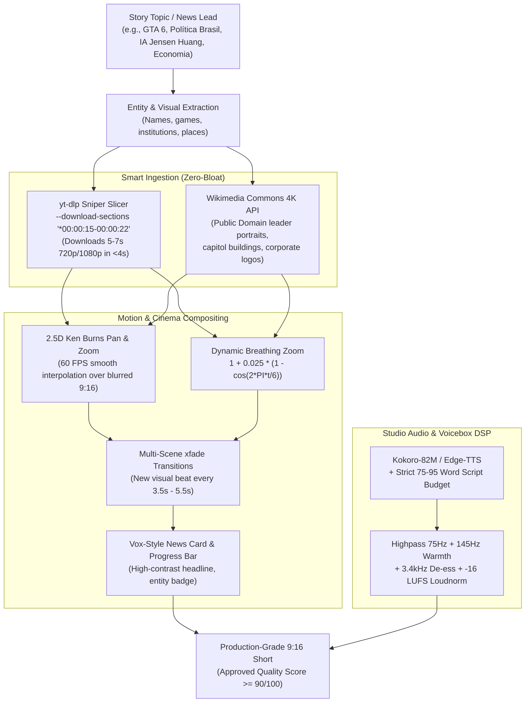

### Supported Topic Archetypes

1. **Games & Pop Culture (e.g., GTA 6, Anime, Cinema)**:
   - Automatically snipes official 4K trailers, developer showcases, and gameplay slices.
   - Preserves high-FPS movement with Lanczos scaling and subtle unsharp filtering.
2. **Humor, Memes, Reacts & Shitposts (e.g., Casimiro, Defante, Smigol, Gaules, Pegadinhas)**:
   - Ultra-dynamic pacing with scene switches every 1.8s–2.2s, punch-in camera zooms, dramatic comedy pauses.
   - Sonic punctuation with clean meme SFX (vine boom, bruh, laughter, whoosh) + kinetic high-contrast captions.
3. **Politics, Geopolitics & World News (e.g., Brasil, STF, G20, White House)**:
   - Queries Wikimedia Commons REST API with automated attribution.
   - Generates high-definition Ken Burns 2.5D vertical camera motion across historic and current imagery.
4. **Tech, AI & Silicon (e.g., Nvidia, Jensen Huang, OpenAI, Elon Musk)**:
   - Mixes keynote b-roll slices with dynamic multi-angle visual hooks.
5. **Finance, Macroeconomics & Commodities (e.g., Selic, Commodities, Câmbio)**:
   - Renders financial cards with procedural ambient audio textures.

---

## Editorial Safe Zones, Audio Mastering & News Hygiene

- **Universal Safe Zone Calibration**: All visual elements (captions, headlines, cards) strictly observe social platform overlays (top 220px for headers/tabs, bottom 450px for handles/audio tags, side rails 35px/100px).
- **Studio Audio Mastering**: -14 to -16 LUFS integrated loudness with true peak capped at <= -1.0 dBTP for distortion-free mobile speaker playback.
- **News Sanitization Firewall**: Automated stripping of promotional blog spam (`Google Discover`, `WhatsApp/Telegram VIP`, partner teasers) and elimination of naive string slicing, guaranteeing titles and hooks never cut off mid-word.

---

## Multi-Language Audio & Whisper Hygiene Guard

When processing international content (such as Japanese anime, French documentaries, or English podcasts), traditional forced transcription models often suffer from **catastrophic acoustic hallucination loops** (e.g. Whisper repeating phrases endlessly). AutoShorts incorporates an end-to-end hygiene firewall:

- **Acoustic Language Probe (`whisper-cli -dl`)**: Runs a 15-second acoustic probe to detect language probability before running full decoding. If Japanese (`ja`) is detected, it automatically routes through `-l ja --translate` to Portuguese instead of forcing a mismatched acoustic alphabet.
- **Strict Cue Deduplication**: Strips sequential identical subtitle cues from `.ass` karaoke tracks before burn-in.
- **Title Truthfulness Guard**: Automatically checks audio metadata: if audio is original Japanese and subtitled, titles are labeled `"Cena Épica Legendada!"` and **never** falsely tagged as `"Dublada!"`.

---

## 24/7 Autonomous Daemon & Multi-Platform Delivery

The production stack on Android Termux runs under a 3-tier supervisor:
- **`runsv` Supervisor**: Continuously monitors `autoshorts`, `autoshorts-web`, and `autoshorts-tunnel`.
- **`autoshorts watch 30`**: Native C11 binary watchdog verifying HTTP endpoint health, Wi-Fi wake-locks, and automatic restart on memory pressure.
- **Smart Autopublish Engine**: Enforces organic publishing intervals and daily quota caps across **YouTube Shorts**, **Instagram Reels**, and **TikTok**, automatically dispatching approved shorts as each platform's window opens.

---

## Quick Start

### 1. Android (Termux `aarch64`)

```bash
git clone https://github.com/ManoAlee/auto-shorts-android.git
cd auto-shorts-android
cp .env.example .env

# Install core Termux runtime (python, ffmpeg, yt-dlp, termux-api, optional whisper.cpp)
bash scripts/install_termux.sh

# Optional: install offline Kokoro-82M PT-BR StyleTTS2 engine
bash scripts/install_kokoro_ptbr.sh

# Start Web Studio (:8787) + C11 background watchdog
bash scripts/start_webapp.sh 8787
```

### 2. Local CLI / Desktop

```bash
# Autonomous 9:16 Shorts cut (offline heuristic or configured LLM)
python main.py "https://www.youtube.com/watch?v=VIDEO_ID" --niche podcast --platform youtube_shorts --layout blur_bg

# Launch Web Studio on localhost:8787
python main.py --serve --port 8787
```

### 3. Windows C# Desktop Companion (Optional)

```powershell
C:\Windows\Microsoft.NET\Framework64\v4.0.30319\csc.exe /nologo /target:winexe /out:desktop-cs\AutoShortsDesktop.exe /reference:System.Web.Extensions.dll desktop-cs\AutoShortsDesktop.cs
```

### 4. Production Guardrails & `.env` Configuration

| Variable / Mechanism | Default / Behavior | Purpose |
| :--- | :--- | :--- |
| `WIFI_ONLY=1` | Enforced on Termux (`wlan0`/`wlan1` `SIOCGIFADDR` ioctl) | Prevents mobile/4G data consumption across `smart_autopublish.py` and `autoshorts-tunnel` |
| `_AUTOPUBLISH_LOCK` | Threading mutex in `smart_autopublish.py` | Serializes `run_smart_publish_cycle()` to prevent duplicate concurrent posts |
| **Instagram Stories & Highlights** | `video_upload_to_story` + `_ensure_reel_thumbnail()` | Uploads real 9:16 video + fresh cover frame (no black canvas) and auto-routes to niche Highlights (`🔥 Animes`, `📰 Notícias`) |
| **Post-Publish Vault Audit** | `GET /api/publish/audit` (`thumbnail_sha256`) | Detects stale/duplicate thumbnails across sibling packs and verifies live media state |
| **Hook Title Hygiene** | `_polish_hook_phrase()` + `_pick_best_hook()` | Rejects incoherent spoken fragments (`"a gente "`, `"eu "`, `"você "`, etc.) and enforces niche keyword relevance on cover hooks |

---

## HTTP & OpenAI-Compatible API (`:8787`)

- `GET /` — Modular Studio Web UI (`Cache-Control: no-store`)
- `GET /api/status` — Live 5-stage render progress (`stage_index`, `progress_pct`, `elapsed_sec`, queue state)
- `GET /api/videos?status=all|approved|queued|published&q=...&limit=100&offset=0` — Paginated library with Opus Scorecard & visual audit metrics
- `GET /api/horizon?topic=todos` & `GET /api/hype/live` — Multi-niche trend feed & domain-diversified Google Trends BR + live portals radar
- `POST /api/run` & `POST /api/news/generate` — Enqueue YouTube clip discovery, URL cutting (`9:16`), or live radar news generation
- `POST /api/narrate` — Enqueue humanized Edge-TTS (`capcut_julia`, `capcut_cleyton`) / Kokoro PT-BR + Semantic B-Roll narration render
- `POST /api/auto-validate-all` & `POST /api/optimize` — End-to-end validation, English-to-PT-BR healing, hook sanitization, duplicate detection, and YouTube upload queue dispatch
- `GET /api/publish/audit`, `GET /api/autopublish/plan`, `GET /api/tools/validate`, `GET /api/tunnel`, `GET /api/system` — Post-publish SHA-256 thumbnail audit, autopublish schedule, toolchain health, and active Cloudflare tunnel URL
- `GET /v1/models`, `POST /v1/chat/completions`, `POST /api/ai/chat`, `POST /api/ai/benchmark` — Offline ARM64/BM25 RAG assistant & local inference telemetry

---

## Repository Structure

```text
auto-shorts-android/
├── .github/                  # GitHub Actions CI, CODEOWNERS, PR & Issue templates
├── assets/
│   ├── fonts/                # AlbertSans-ExtraBold.ttf, TikTokSans-VF.otf, Optimistic_VF_App_Lite.ttf
│   ├── luts/                 # lut_capcut_base.png + 13 YouTube Shorts HaldCLUTs
│   └── voices/               # CC-BY-SA Open-Swara PT-BR voice reference WAVs
├── desktop-cs/               # C# .NET Framework WinForms companion app
├── docs/                     # Architecture guides, benchmarks & Studio screenshots
├── native-c/                 # C11 Termux watchdog & fast MP4 container auditor
├── scripts/                  # Termux installers, Kokoro setup, render_capcut_shorts.py & daemons
├── src/auto_shorts/          # Core Python package (humanizer, narrator, semantic_visual_engine, UI)
├── tests/                    # Automated pytest suite
├── main.py                   # CLI & Studio entrypoint
├── mcp_server.py             # MCP bridge server
└── pyproject.toml            # Packaging, pytest & ruff configuration
```

---

## Documentation

- [Motor Autônomo 24/7: Episódios Longos & Radar de Incidentes Críticos](docs/MOTOR_AUTONOMO_EPISODIOS_E_INCIDENTES.md)
- [Mahoraga 8-Spoke Adaptive Intelligence Engine](docs/MAHORAGA_ADAPTIVE_ENGINE.md)
- [Arquitetura Completa e Guia de Produção](docs/ARQUITETURA_E_PRODUCAO.md)
- [Estudo de Engenharia Reversa](docs/ESTUDO_ENGENHARIA_REVERSA.md)
- [Modelos de IA Local no Android](docs/ESTUDO_MODELOS_IA_LOCAL_ANDROID.md)
- [Nichos, Retenção e Monetização no Brasil](docs/ESTUDO_NICHOS_MONETIZACAO_BRASIL.md)
- [Entrega, Portais e Evolução](docs/ESTUDO_ENTREGA_PORTAIS_E_EVOLUCAO.md)
- [Ferramentas Open-Source de Referência](docs/FERRAMENTAS_GITHUB_OPENSOURCE.md)
- [IA Local e Integração Google Drive no Termux](docs/IA_E_GOOGLE_DRIVE_NO_TERMUX.md)
- [Qualidade de Voz, Vídeo e Publicação Automática](docs/QUALIDADE_VIDEO_VOZ_E_AUTOPILOT.md)

---

## Verification & Testing

```bash
# Run full Python test suite
python -m pytest tests -q

# Validate frontend JavaScript syntax
node --check src/auto_shorts/frontend/studio.js
```

## Contributing & Security

- Guia técnico de CDP nativo (TikTok & YouTube), Analytics Multiplataforma, Radar Global e Piloto Automático 24/7: [docs/CDP_ANALYTICS_E_PILOTO_AUTOMATICO.md](docs/CDP_ANALYTICS_E_PILOTO_AUTOMATICO.md).
- Contributions welcome — see [CONTRIBUTING.md](CONTRIBUTING.md) and [CHANGELOG.md](CHANGELOG.md).
- Vulnerability reporting and hardening guidelines live in [SECURITY.md](SECURITY.md).
- Released under the [MIT License](LICENSE).
