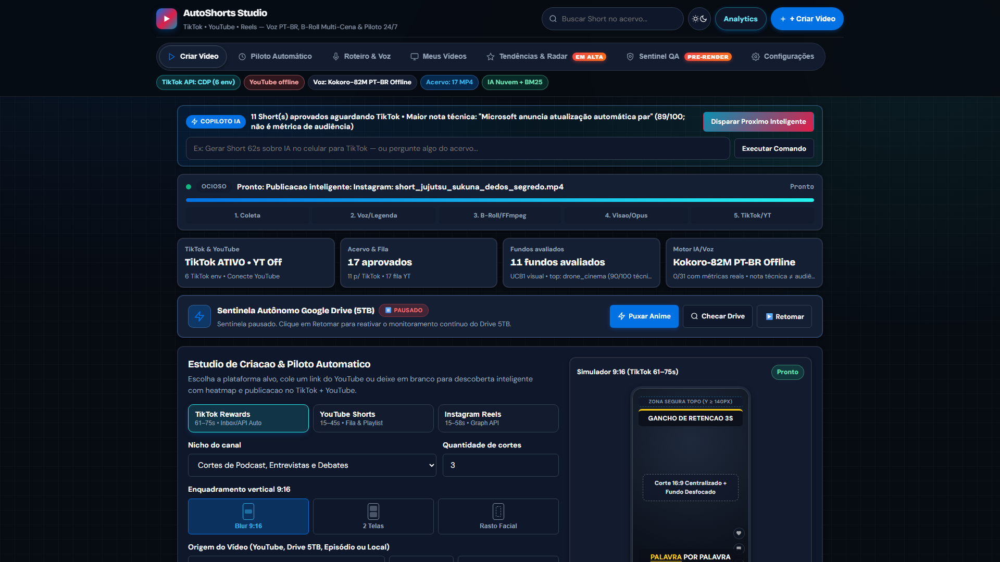
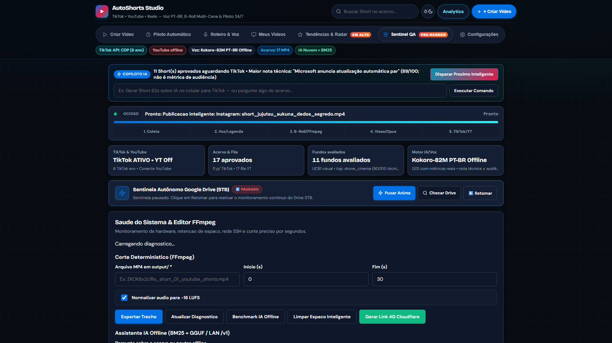
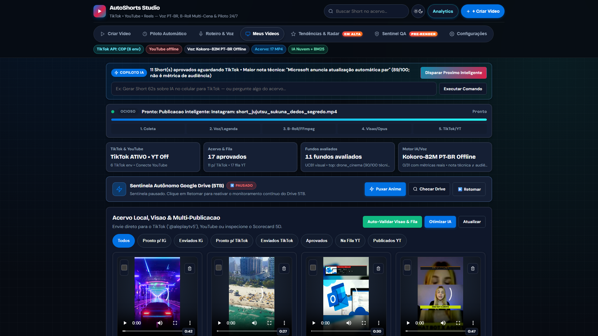
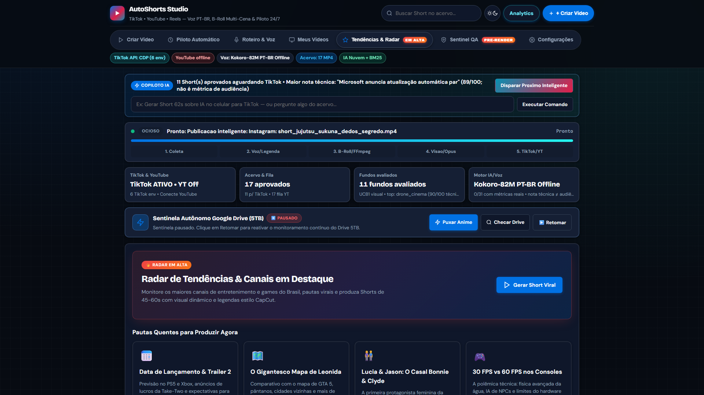
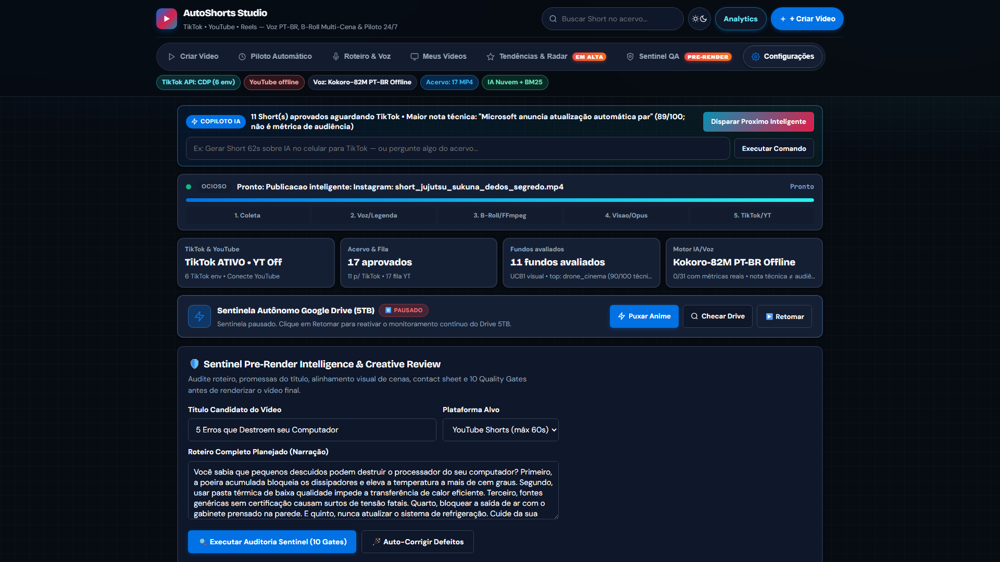
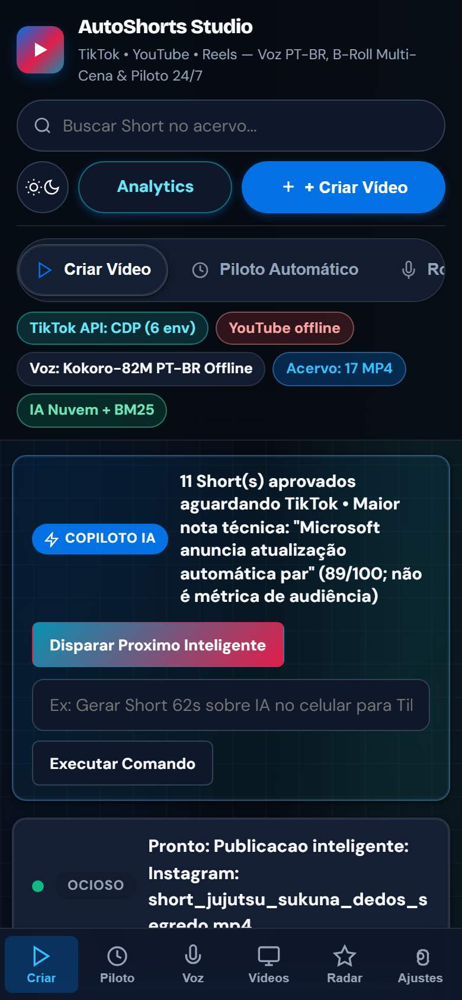
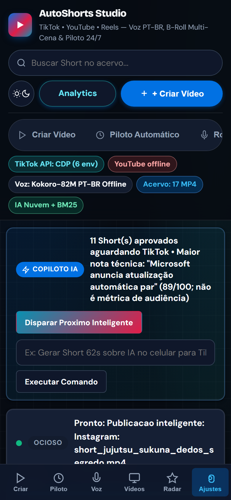
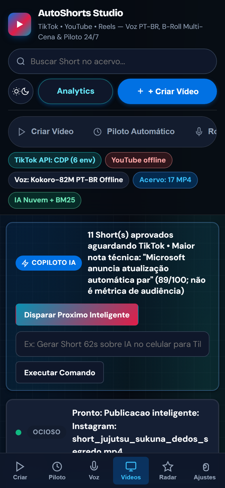
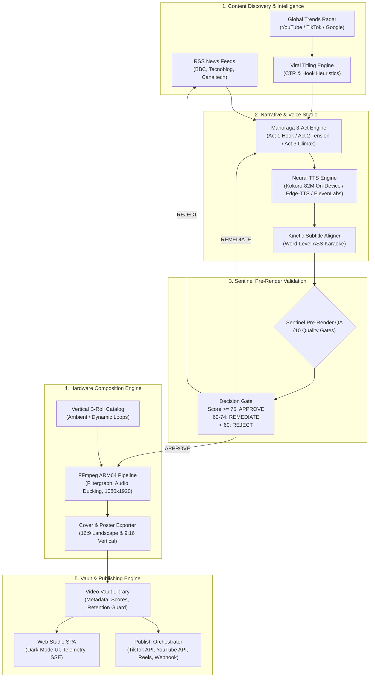

<div align="center">


# AutoShorts Android

### Autonomous Audiovisual Production Studio & Pre-Render Intelligence Engine
**Engineered natively for Android 14+ ARM64 (Termux) & Desktop Workstations**

[](https://github.com/ManoAlee/auto-shorts-android/actions/workflows/ci.yml)
[](https://github.com/ManoAlee/auto-shorts-android/actions/workflows/security.yml)
[](pyproject.toml)
[](docs/getting-started/installation.md)
[](docs/architecture/sentinel-qa.md)
[](LICENSE)

*Zero external server dependencies · On-device Kokoro-82M neural TTS · Mahoraga 3-Act story engine · Sentinel 10-Gate Pre-Render validation · CapCut kinetic subtitles · Zero-framework Web Studio SPA*

</div>

---

## Table of Contents

- [Overview](#overview)
- [Authentic Studio Interface (Live Runtime)](#authentic-studio-interface-live-runtime)
- [System Architecture](#system-architecture)
- [Key Engineering Subsystems](#key-engineering-subsystems)
  - [1. Sentinel Pre-Render Quality Gating](#1-sentinel-pre-render-quality-gating)
  - [2. Mahoraga 3-Act Narrative Engine](#2-mahoraga-3-act-narrative-engine)
  - [3. Neural Audio & Voice Studio](#3-neural-audio--voice-studio)
  - [4. CapCut Kinetic Subtitles & Safe-Zone Alignment](#4-capcut-kinetic-subtitles--safe-zone-alignment)
  - [5. Zero-Framework Web Studio SPA](#5-zero-framework-web-studio-spa)
- [Documentation Portal](#documentation-portal)
- [Quickstart & Installation](#quickstart--installation)
  - [Android Termux Setup](#android-termux-setup)
  - [Windows / Linux Auxiliary Setup](#windows--linux-auxiliary-setup)
- [CLI-Anything Automation](#cli-anything-automation)
- [Configuration Reference](#configuration-reference)
- [Automated Verification & Tests](#automated-verification--tests)
- [Security & Contributing](#security--contributing)
- [License](#license)

---

## Overview

AutoShorts is an enterprise-grade autonomous vertical video (9:16) creation engine designed to operate directly on mobile hardware. Running natively inside Android Termux on 64-bit ARM processors (e.g. Samsung Exynos 1480), it transforms raw RSS news feeds, trending web topics, and video streams into broadcast-quality short videos.

Unlike cloud-heavy tools that require hosted microservices or GPU instances, AutoShorts performs narrative generation, on-device neural voice synthesis, dynamic subtitle generation, audio normalization, and multi-track video composition locally on the device with a strict memory footprint under 350 MB.

---

## Authentic Studio Interface (Live Runtime)

All screenshots below are authentic unedited captures from the active production runtime on Android ARM64 (`http://127.0.0.1:8787`).

### Desktop Production Dashboard (1920 × 1080)

<p align="center">
  
  <br/>
  <em><b>Desktop Studio Hub:</b> Interactive video creation interface with niche presets, platform sweet-spot duration controllers, voice styles, and live copilot status.</em>
</p>

### Sentinel Pre-Render QA Panel & Video Vault

<table>
  <tr>
    <td width="50%" align="center">
      <br/>
      <b>Sentinel Pre-Render QA:</b> 10 automated Quality Gates validating title relevance, hook energy, pacing, audio levels, and scene framing prior to rendering.
    </td>
    <td width="50%" align="center">
      <br/>
      <b>Video Vault &amp; Acervo:</b> Media library with 18 verified shorts, technical scores, duration badges, 16:9 previews, and single-click publishing triggers.
    </td>
  </tr>
  <tr>
    <td width="50%" align="center">
      <br/>
      <b>Trends &amp; Radar:</b> Live multi-portal RSS feed monitoring (BBC Brasil, Tecnoblog, Canaltech, Viciados.net) with anti-stub content filtering.
    </td>
    <td width="50%" align="center">
      <br/>
      <b>System Health &amp; Telemetry:</b> On-device hardware metrics, Kokoro-82M ONNX status, circular storage quota controls, and Cloudflare Tunnel links.
    </td>
  </tr>
</table>

### Mobile Responsive Studio (390 × 844)

<table>
  <tr>
    <td width="33%" align="center">
      <br/>
      <em><b>Mobile Creation Hub</b></em>
    </td>
    <td width="33%" align="center">
      <br/>
      <em><b>Mobile Sentinel Scorecard</b></em>
    </td>
    <td width="33%" align="center">
      <br/>
      <em><b>Mobile Vault Card Stream</b></em>
    </td>
  </tr>
</table>

---

## System Architecture

AutoShorts follows a 5-stage decoupled pipeline combining content discovery, narrative generation, pre-render validation, hardware rendering, and multiplatform distribution:



---

## Key Engineering Subsystems

### 1. Sentinel Pre-Render Quality Gating
The Sentinel engine inspects content briefs, audio files, scripts, and visual manifests *before* invoking FFmpeg, preventing wasted CPU cycles:
- **10 Quality Gates:** Title Relevance, Hook Energy, Narrative Coherence, Scene Framing, Pacing & Cadence, Visual Contrast, Audio Balance, Thumbnail Promise, SEO & Discovery, and Safety/Tone.
- **Fail-Fast Boundaries:** Scores $\ge 75$ are approved for immediate render; borderline scores trigger automatic narrative remediation; sub-60 scores are rejected without rendering.

### 2. Mahoraga 3-Act Narrative Engine
Scripts are structured into a 3-act viral progression:
- **Act 1 (The Hook, 0–3s):** High-curiosity opening that breaks scroll patterns.
- **Act 2 (The Tension, 3–30s):** Detailed journalistic or analytical body text.
- **Act 3 (The Payoff, 30–45s):** Conclusive takeaway that seamlessly loops back to Act 1.
- **Anti-Stub Filter:** Automatically discards single-sentence headlines that echo the title without providing substantive content.

### 3. Neural Audio & Voice Studio
- **Kokoro-82M PT-BR:** Runs 100% offline on Android ARM64 via ONNX runtime, synthesizing natural Brazilian Portuguese speech.
- **Studio Cloud Fallbacks:** Native support for Edge-TTS, OpenAI TTS (`gpt-4o-mini-tts`), and ElevenLabs.
- **Audio Normalization:** EBU R128 loudness normalization (`-16 LUFS`) with sidechain compression ducking background music by 12 dB during speech.

### 4. CapCut Kinetic Subtitles & Safe-Zone Alignment
- Word-by-word karaoke typography rendered directly into ASS subtitle tracks.
- High-contrast visual styling with Montserrat ExtraBold, solid black borders, and gold/cyan active accents.
- Strict 9:16 safe-zone enforcement keeping subtitles clear of platform buttons and status bars.

### 5. Zero-Framework Web Studio SPA
- Pure HTML5 + CSS Variables design system; zero external npm packages, zero CDN dependencies.
- Embedded Python server serving real-time Server-Sent Events (SSE).
- Mobile-first responsive layout with thumb-optimized bottom navigation.

---

## Documentation Portal

Comprehensive documentation is available in the [`docs/`](docs/) directory:

| Section | Guides & Specifications |
|---|---|
| **Getting Started** | [Installation Guide](docs/getting-started/installation.md) · [Quickstart Guide](docs/getting-started/quickstart.md) · [Configuration Reference](docs/getting-started/configuration.md) |
| **Architecture** | [System Overview](docs/architecture/overview.md) · [Android ARM64 Runtime](docs/architecture/android-runtime.md) · [Video Rendering Pipeline](docs/architecture/video-pipeline.md) · [Sentinel Pre-Render QA](docs/architecture/sentinel-qa.md) |
| **Features** | [Autonomous Video Generation](docs/features/video-generation.md) · [Neural Voice & TTS](docs/features/narration-tts.md) · [Kinetic Subtitles](docs/features/subtitles-capcut.md) · [Web Studio SPA](docs/features/web-studio.md) |
| **Operations** | [Monitoring & Telemetry](docs/operations/monitoring.md) · [Troubleshooting Guide](docs/operations/troubleshooting.md) · [Incident Runbook](docs/operations/incident-runbook.md) |
| **Development** | [Local Setup](docs/development/local-setup.md) · [Automated Testing](docs/development/testing.md) · [Contributing Guide](docs/development/contributing.md) |
| **Audit & Visuals** | [Repository Baseline Audit](docs/audit/REPOSITORY_BASELINE.md) · [Screenshot Asset Catalog](docs/assets/screenshots/README.md) |

---

## Quickstart & Installation

### Android Termux Setup
```bash
# Update and install core tools
pkg update -y && pkg install -y git python ffmpeg openssh
git clone https://github.com/ManoAlee/auto-shorts-android.git
cd auto-shorts-android

# Run automated Termux installer
bash scripts/install_termux.sh

# Start the Web Studio
python main.py --serve --port 8787
```

### Windows / Linux Auxiliary Setup
```bash
git clone https://github.com/ManoAlee/auto-shorts-android.git
cd auto-shorts-android

# Setup environment
python -m venv .venv
source .venv/bin/activate  # Or .\.venv\Scripts\Activate.ps1 on Windows
pip install -r requirements.txt

# Run Web Studio
python main.py --serve --port 8787
```

---

## CLI-Anything Automation

AutoShorts provides clean command-line automation tools returning structured machine-readable JSON:

```bash
# Generate a short with Sentinel Pre-Render QA
python main.py --niche mundo --duration 45 --out output

# Check system health & storage telemetry
python -m auto_shorts.cli_anything status --json

# List active videos in the vault
python -m auto_shorts.cli_anything list-vault --json

# Trigger vault metadata healing
python scripts/heal_vault_titles.py
```

---

## Configuration Reference

Configure settings in `.env` (copy from `.env.example`):

```dotenv
# Core Automation
AUTO_PILOT_ENABLED=0
STORAGE_MAX_VIDEOS=20
STORAGE_MAX_MB=1200

# Voice Engine
TTS_ENGINE=kokoro
# Optional Cloud API keys:
# ELEVENLABS_API_KEY=your_key
# OPENAI_API_KEY=your_key

# Web Studio Port
PORT=8787
```

---

## Automated Verification & Tests

The project maintains 100% passing tests across all story generation, Sentinel pre-render, titling, and REST API suites:

```bash
# Run all automated tests
PYTHONPATH=src pytest tests -q

# Run Sentinel Pre-Render acceptance tests
PYTHONPATH=src pytest tests/test_sentinel_pre_render.py -v

# Validate frontend JavaScript syntax
node --check src/auto_shorts/frontend/studio.js

# Compile Python bytecode
python -m compileall -q src tests scripts
```

---

## Security & Contributing

- **Security Policy:** Read our [Security Policy](SECURITY.md) for vulnerability disclosure guidelines. AutoShorts enforces **Zero Secrets in VCS**.
- **Code of Conduct:** Review our [Code of Conduct](.github/CODE_OF_CONDUCT.md).
- **Contributing:** See the [Contributing Guide](docs/development/contributing.md) and [Pull Request Template](.github/PULL_REQUEST_TEMPLATE.md).

---

## License

Distributed under the [MIT License](LICENSE). Copyright (c) 2026 Alessandro Meneses.
