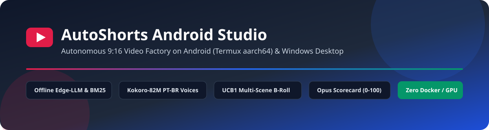
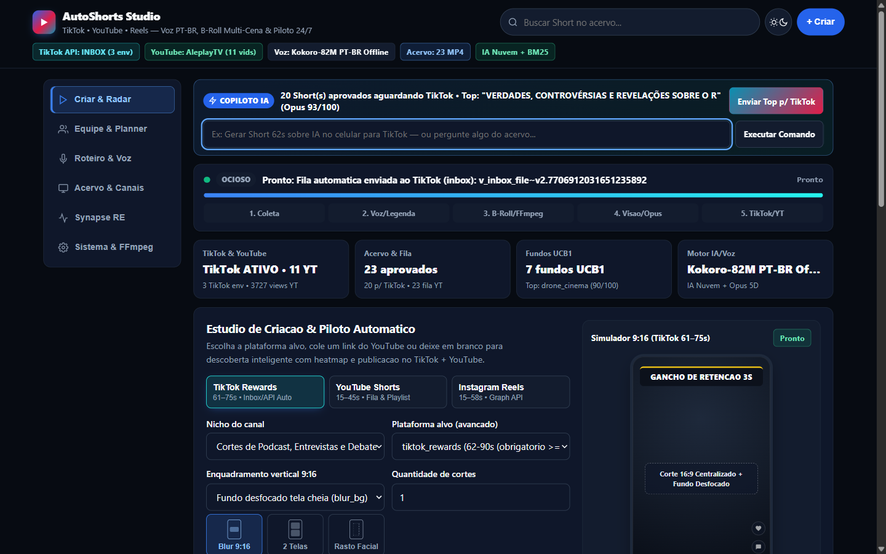
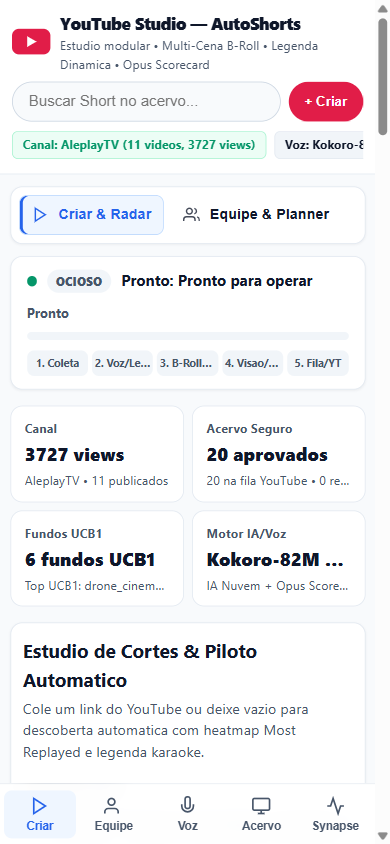
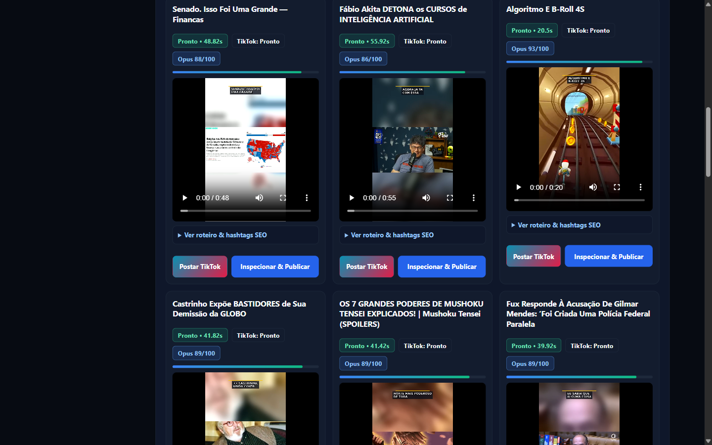

<div align="center">



[](https://github.com/ManoAlee/auto-shorts-android/actions/workflows/ci.yml)
[](pyproject.toml)
[](scripts/install_termux.sh)
[](#verification--testing)
[](LICENSE)

**Autonomous 9:16 Vertical Video Factory engineered for Android (`Termux aarch64`) & Windows Desktop**  
*Zero PyTorch/Docker bloat · Offline Edge-LLM + BM25 RAG · Kokoro-82M PT-BR & Open-Swara Voices · Multi-Scene B-Roll · Opus Scorecard QA*

</div>

---

## Live Studio Preview

<table>
  <tr>
    <td width="64%" align="center">
      <br/>
      <sub><b>Desktop Studio (`:8787`)</b> — Modular sidebar rail, UCB1 B-Roll KPIs, Framing Tiles &amp; interactive 9:16 simulator</sub>
    </td>
    <td width="36%" align="center">
      <br/>
      <sub><b>Mobile Android View (`390x844`)</b> — Zero horizontal overflow &amp; native bottom navigation</sub>
    </td>
  </tr>
  <tr>
    <td colspan="2" align="center">
      <br/>
      <sub><b>Live 5-Stage Render Stepper</b> — Real-time progress across Coleta -> Voz/Legenda -> B-Roll/FFmpeg -> Visao/Opus -> Fila/YT</sub>
    </td>
  </tr>
</table>

---

## System Architecture

```mermaid
flowchart LR
  subgraph Discovery["1. Multi-Source Discovery"]
    HR["Horizon Radar\n(Podcasts, Tech/IA, Finanças)"]
    AN["AniList / Jikan\n(4 Anime Feeds)"]
    WN["World News RSS\n(Auto PT-BR)"]
    YT["YouTube InnerTube\n(Most Replayed Heatmaps)"]
  end

  subgraph Intelligence["2. AI Script, Hygiene & Offline RAG"]
    LLM["OpenRouter / Gemini /\nllama-cli GGUF (--single-turn)"]
    BM25["BM25 Local Search\n+ CoT & Hook Sanitizer"]
  end

  subgraph Production["3. Audio & 9:16 Video Pipeline"]
    TTS["Kokoro-82M PT-BR / Edge-TTS /\nCosyVoice + Open-Swara WAVs\n(Warm Broadcast EQ + Trim)"]
    BR["UCB1 Multi-Scene B-Roll\n(~4.2s switches + Sidechain -16 LUFS)"]
    SUB["Progressive \\kf Karaoke\n(.ass + Whisper / WordBoundary)"]
  end

  subgraph QA["4. Quality Gate & Delivery"]
    AUD["5-Frame Vision & Signalstats\n+ Opus Scorecard (0-100)"]
    DEDUP["Duplicate Queue Guard\n+ Auto-Optimize Metadata"]
    PUB["YouTube Data API v3\nInstagram Reels / Webhook"]
  end

  Discovery --> Intelligence --> Production --> QA
```



---

## Key Capabilities

| Layer | Highlights | Modules |
| :--- | :--- | :--- |
| **Web Studio UI (`:8787`)** | Modular responsive shell, persistent 5-stage live render stepper + floating scroll dock, interactive 9:16 framing preview with YouTube thumbnail auto-load, segmented Top-6 radar, accessible `<dialog>` inspector, zero-cache headers | [`src/auto_shorts/frontend/`](src/auto_shorts/frontend/), [`webapp.py`](src/auto_shorts/webapp.py) |
| **Offline Edge-LLM & BM25** | ARM64 SoC ISA probing (`dotprod`/`asimddp`, `fp16`, `i8mm`, `sve`), RAM-tiered GGUF catalog, `<think>`/`<thought>` CoT stripping, pure-Python BM25 local RAG, `/v1/chat/completions`, `/api/ai/benchmark` | [`offline_llm.py`](src/auto_shorts/offline_llm.py), [`highlights.py`](src/auto_shorts/highlights.py) |
| **Humanized PT-BR Voice** | PT-BR spoken normalization (`R$`, `%`, `IA`, `EUA`, `STF`, `km/h`), broadcast warmth EQ + de-esser, Kokoro-82M offline + CosyVoice/F5-TTS/GPT-SoVITS failover with CC-BY-SA Open-Swara Portuguese reference WAVs | [`narrator.py`](src/auto_shorts/narrator.py), [`assets/voices/`](assets/voices/) |
| **9:16 Video & B-Roll** | `blur_bg`, `split_top_bottom`, facial-tracked `center_crop`, dynamic ~4.2s multi-scene B-roll + UCB1 evolution bandit, `-16 LUFS` loudnorm & sidechain ducking | [`renderer.py`](src/auto_shorts/renderer.py), [`gameplay.py`](src/auto_shorts/gameplay.py), [`evolution.py`](src/auto_shorts/evolution.py) |
| **QA & Opus Scorecard** | `ffprobe` & `ffmpeg signalstats` luminance/motion/freeze checks, 5D Opus Scorecard (0–100), subtitle coverage checks, duplicate queue guard | [`validator.py`](src/auto_shorts/validator.py), [`re_engine.py`](src/auto_shorts/re_engine.py), [`publisher.py`](src/auto_shorts/publisher.py) |
| **Autonomous 24/7 & Episode Slicer** | Zero-auth full anime episode scraper (Archive.org/AnimesDigital), automatic OP/ED 90s skipping, clímax detection with authentic BR dubbing preservation (-14 LUFS), real-time Tech Outage RCA sentinel | [`sentinel.py`](src/auto_shorts/sentinel.py), [`anime_archive_downloader.py`](src/auto_shorts/anime_archive_downloader.py), [`world_news.py`](src/auto_shorts/world_news.py) |
| **Native C11 & C# Desktop** | C11 watchdog (`autoshorts`) & zero-exec MP4 auditor (`media_audit`); Windows `.NET WinForms` companion (`IDisposable` safe HTTP/FFmpeg + Opus inspector) | [`native-c/`](native-c/), [`desktop-cs/AutoShortsDesktop.cs`](desktop-cs/AutoShortsDesktop.cs) |

---

## Quick Start

### 1. Android (Termux `aarch64`)

```bash
git clone https://github.com/ManoAlee/auto-shorts-android.git
cd auto-shorts-android
cp .env.example .env

# Install core Termux runtime (python, ffmpeg, yt-dlp, termux-api, optional whisper.cpp)
bash scripts/install_termux.sh

# Optional: install offline Kokoro-82M PT-BR StyleTTS2 engine
bash scripts/install_kokoro_ptbr.sh

# Start Web Studio (:8787) + C11 background watchdog
bash scripts/start_webapp.sh 8787
```

### 2. Local CLI / Desktop

```bash
# Autonomous 9:16 Shorts cut (offline heuristic or configured LLM)
python main.py "https://www.youtube.com/watch?v=VIDEO_ID" --niche podcast --platform youtube_shorts --layout blur_bg

# Launch Web Studio on localhost:8787
python main.py --serve --port 8787
```

### 3. Windows C# Desktop Companion (Optional)

```powershell
C:\Windows\Microsoft.NET\Framework64\v4.0.30319\csc.exe /nologo /target:winexe /out:desktop-cs\AutoShortsDesktop.exe /reference:System.Web.Extensions.dll desktop-cs\AutoShortsDesktop.cs
```

---

## HTTP & OpenAI-Compatible API (`:8787`)

- `GET /` — Modular Studio Web UI (`Cache-Control: no-store`)
- `GET /api/status` — Live 5-stage render progress (`stage_index`, `progress_pct`, `elapsed_sec`, queue state)
- `GET /api/videos?status=all|approved|queued|published&q=...&limit=100&offset=0` — Paginated library with Opus Scorecard & visual audit metrics
- `GET /api/horizon?topic=todos` — Multi-niche trend feed with background warm cache
- `POST /api/run` — Enqueue YouTube clip discovery or URL cutting (`9:16`)
- `POST /api/narrate` — Enqueue Kokoro PT-BR + Multi-Scene B-Roll narration render
- `POST /api/auto-validate-all` & `POST /api/optimize` — End-to-end validation, English-to-PT-BR healing, hook sanitization, duplicate detection, and YouTube upload queue dispatch
- `GET /v1/models`, `POST /v1/chat/completions`, `POST /api/ai/chat`, `POST /api/ai/benchmark` — Offline ARM64/BM25 RAG assistant & local inference telemetry

---

## Repository Structure

```text
auto-shorts-android/
├── .github/                  # GitHub Actions CI, CODEOWNERS, PR & Issue templates
├── assets/voices/            # CC-BY-SA Open-Swara PT-BR voice reference WAVs
├── desktop-cs/               # C# .NET Framework WinForms companion app
├── docs/                     # Architecture guides, benchmarks & Studio screenshots
├── native-c/                 # C11 Termux watchdog & fast MP4 container auditor
├── scripts/                  # Termux installers, Kokoro setup & daemon launchers
├── src/auto_shorts/          # Core Python package + modular frontend UI
├── tests/                    # Automated pytest suite
├── main.py                   # CLI & Studio entrypoint
├── mcp_server.py             # MCP bridge server
└── pyproject.toml            # Packaging, pytest & ruff configuration
```

---

## Documentation

- [Motor Autônomo 24/7: Episódios Longos & Radar de Incidentes Críticos](docs/MOTOR_AUTONOMO_EPISODIOS_E_INCIDENTES.md)
- [Mahoraga 8-Spoke Adaptive Intelligence Engine](docs/MAHORAGA_ADAPTIVE_ENGINE.md)
- [Arquitetura Completa e Guia de Produção](docs/ARQUITETURA_E_PRODUCAO.md)
- [Estudo de Engenharia Reversa](docs/ESTUDO_ENGENHARIA_REVERSA.md)
- [Modelos de IA Local no Android](docs/ESTUDO_MODELOS_IA_LOCAL_ANDROID.md)
- [Nichos, Retenção e Monetização no Brasil](docs/ESTUDO_NICHOS_MONETIZACAO_BRASIL.md)
- [Entrega, Portais e Evolução](docs/ESTUDO_ENTREGA_PORTAIS_E_EVOLUCAO.md)
- [Ferramentas Open-Source de Referência](docs/FERRAMENTAS_GITHUB_OPENSOURCE.md)

---

## Verification & Testing

```bash
# Run full Python test suite
python -m pytest tests -q

# Validate frontend JavaScript syntax
node --check src/auto_shorts/frontend/studio.js
```

## Contributing & Security

- Contributions welcome — see [CONTRIBUTING.md](CONTRIBUTING.md) and [CHANGELOG.md](CHANGELOG.md).
- Vulnerability reporting and hardening guidelines live in [SECURITY.md](SECURITY.md).
- Released under the [MIT License](LICENSE).
