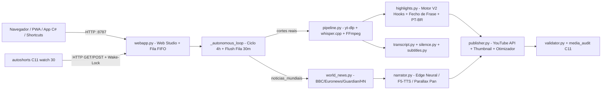

# AutoShorts Android — Arquitetura Completa, Motor V2 e Guia de Produção

Documentação consolidada da operação em produção no Android (`Termux aarch64`, modelo testado `SM-A556E` / Android 16), cliente desktop C# e auditor/watchdog nativo em C11.

---

## 1. Arquitetura do Sistema



### Camadas e Arquivos Principais
- **Nucleo Web, Fila & Agendador (`src/auto_shorts/webapp.py`)**
  - Servidor `ThreadingHTTPServer` na porta `8787` com headers de seguranca (`X-Content-Type-Options: nosniff`, `X-Frame-Options: DENY`, `Referrer-Policy: no-referrer`), protecao contra SSRF (`_is_safe_public_http_url`), traversal (`_safe_child_path`) e limite de `1 MB` por payload (`_MAX_POST_BYTES`).
  - **Fila FIFO (`_enqueue_job` + `_JOB_LOCK` `RLock`):** evita erros `409 Conflict` em cliques simultaneos e impede deadlock no piloto automatico.
  - **Auto-cura de Acervo (`POST /api/optimize` e `POST /api/validate`):** aciona [`optimize_existing_publish_pack`](file:///c:/Users/alessandro.meneses.Automotion/Documents/01_Projetos_TI/linux-android/auto-shorts-android/src/auto_shorts/publisher.py) para corrigir MP4s sem `.publish.json`, traduzir titulos em ingles, ajustar hooks e manter `3–5` hashtags.
- **Motor V2 de Cortes, Hooks e Fechamento (`src/auto_shorts/highlights.py`)**
  - Cascatas de IA com fallback automatico: `OpenRouter` (`llama-3.3-70b-instruct:free`, `gemma-3-12b-it:free`, `qwen-2.5-72b-instruct:free`, `openrouter/free`) -> `Gemini` -> `llama-server` local (`127.0.0.1:8080`) -> heuristica offline PT-BR.
  - **Fecho de Frase (`_ends_complete_sentence`, `_snap_end_to_sentence`):** impede cortes no meio de palavras/frases ao alinhar o encerramento do clipe em pontuacao terminal (`.`, `!`, `?`) dentro da janela permitida, pontuando extras para fechamentos conclusivos ou de gancho (`?`).
  - **Hooks & Titulos PT-BR (`_polish_hook_phrase`, `_looks_english_title`, `_translate_title_to_ptbr`):** remove inicios fracos (`DELE`, `ENTAO`, `MANO`), impede corte em preposicao/artigo final e traduz automaticamente titulos auto-traduzidos do YouTube para portugues do Brasil.
- **Legendas Word-Synced e Corte de Silencio (`transcript.py`, `silence.py`, `subtitles.py`)**
  - `parse_vtt` / `parse_srt` linha-a-linha com suporte a timestamps `<HH:MM:SS.mmm>` e juncao limpa de subwords BPE do `whisper.cpp`.
  - `remap_transcript_segments` mapeia palavras por ponto medio sem duplicacao apos cortes de silencio.
  - Pastas de trabalho isoladas por execucao (`_work_{run_tag}`) impedindo colisoes de `source.mp4` entre videos diferentes.
- **Noticias Mundiais para o Brasil (`src/auto_shorts/world_news.py`)**
  - Fontes sem chave: `BBC News Brasil`, `Euronews Mundo`, `BBC World News`, `The Guardian`, `Spaceflight News API v4`, `Wikipedia Current Events` e `Hacker News`.
  - Traducao PT-BR em cascata + gancho completo (`_build_complete_news_hook`) + foto real da materia com movimento parallax linear rapido + barra de progresso vermelha (`_build_news_backdrop_video`) + badge limpo (`MUNDO HOJE` via `get_niche_badge` em `config.py`).
- **Empacotamento, YouTube API & Score Algoritmico (`publisher.py`, `yt_algorithm.py`, `validator.py`)**
  - Tags calibradas em `4–5` por nicho (incluindo `podcast` e `entretenimento_animes` com 5 tags), limpeza de `<`/`>`, upload OAuth2 de video + capa 16:9 + inclusao em playlist do nicho.
  - Score algoritmico (0–100) cobrindo gancho 1–3s, duracao, ritmo de legendas, metadados Search/Shorts e loudness `-14 LUFS` / formato vertical `9:16`.
- **Nativo C11 (`native-c/autoshorts.c`, `native-c/media_audit.c`, `native-c/mp4_audit.h`)**
  - Compilado com `clang -O2 -Wall -Wextra -std=c11` para `bin/autoshorts` e `bin/media_audit`.
  - Valida boxes ISO-BMFF (`ftyp`/`moov`), resolucao `720x1280` e duracao sem depender de Python.
  - `autoshorts watch 30` monitora a porta `:8787`, reergue o servidor se cair e dispara ciclo pendente quando a rede Wi-Fi reconecta.
- **MCP Server & Desktop C# (`mcp_server.py`, `desktop-cs/AutoShortsDesktop.cs`)**
  - Expoe `yt_world_news_brazil` e ferramentas do estudio via JSON-RPC stdio; cliente Windows em .NET WinForms para controle remoto via LAN.

---

## 2. Operacao Autonoma em Producao e Persistencia no Android

### Fluxo Automatico (`output/scheduler.json`)
- Configuracao ativa padrao de producao:
  - `enabled: true`
  - `interval_hours: 4` (ate ~6 ciclos/dia evitando rajadas anti-spam)
  - `niche: "all"` (rotaciona entre 8 nichos: `noticias_mundiais`, `entretenimento_animes`, `ia_tech`, `financas`, `podcast`, `desenvolvimento_pessoal`, `saude_fitness`, `concursos`)
  - `platform: "youtube_shorts"`
  - `auto_publish: true`

### Tratamento de Cota Diaria do YouTube (`uploadLimitExceeded`)
- **O que e:** trava anti-spam por canal do proprio YouTube em **janela movel de 24 horas** (`HTTP 400`, `reason: "uploadLimitExceeded"`). Nao e erro de codigo nem falta de token OAuth2.
- **Como o sistema responde automaticamente:**
  - `POST /api/publish` registra `queued_for_auto_publish: true` e `delivery_status: "queued_quota_limit"` no `.publish.json`, retornando `HTTP 202` amigavel na interface.
  - Dentro de [`_autonomous_loop`](file:///c:/Users/alessandro.meneses.Automotion/Documents/01_Projetos_TI/linux-android/auto-shorts-android/src/auto_shorts/webapp.py), [`_flush_pending_publishes`](file:///c:/Users/alessandro.meneses.Automotion/Documents/01_Projetos_TI/linux-android/auto-shorts-android/src/auto_shorts/webapp.py) varre os `.publish.json` validados sem `youtube.video_id` a cada **30 minutos** (quando ha internet) e publica 1 por vez assim que a janela de 24h libera novas vagas.
- **Como aumentar o teto do canal:** habilitar **Recursos Avancados** no YouTube Studio (`Configuracoes > Canal > Qualificacao para recursos`).

### Como Manter Rodando ao Fechar o Termux (`Android 16 / Samsung SM-A556E`)
1. **Desacoplamento automatico ja ativo no codigo (`scripts/start_webapp.sh`):**
   - `main.py --serve --port 8787` e `bin/autoshorts watch 30` iniciam com `nohup setsid ... < /dev/null &` (`PPID = 1`, sessoes independentes `Ss`/`Ssl`) + `termux-wake-lock`.
   - Fechar abas de terminal (`exit`) ou sessoes SSH **nao** derruba os daemons.
2. **Inicializacao no boot (`~/.termux/boot/start-autoshorts.sh`):**
   - Ao ligar o celular (com app **Termux:Boot** instalado), sobe `termux-wake-lock`, `sshd`, servidor `:8787` e watchdog C.
3. **Configuracao unica no Android / One UI (para sobreviver ao gesto de limpar Recentes):**
   - **Configuracoes -> Aplicativos -> Termux -> Bateria -> Sem restricoes** (aplicar tambem ao **Termux:Boot**).
   - Abrir **Apps Recentes** -> tocar no icone do **Termux** -> **Manter aberto / Travar** para impedir encerramento forcado pelo launcher ao deslizar para cima.

---

## 3. Endpoints Web Studio (`http://<IP-CELULAR>:8787`)

| Metodo | Rota | Funcao |
|:--|:--|:--|
| `GET` | `/` | Interface Web Studio PT-BR + PWA (`manifest.webmanifest`, `icon.svg`) |
| `GET` | `/api/status` | Estado atual do worker (`running`, `queued`, `last_status`, `last_result`) |
| `GET` | `/api/videos` | Lista e ranqueia o acervo local em `output/` (`{"videos": [...]}`) |
| `GET` | `/api/channel` | Telemetria do canal YouTube autenticado (`AleplayTV`) |
| `GET` | `/api/system` | Espaco em disco, ferramentas (`ffmpeg`, `whisper`, `media_audit`), chaves e status de IA |
| `GET` | `/api/scheduler` | Estado atual do agendador (`output/scheduler.json`) |
| `GET` | `/api/anime/trending` / `/api/world-news` / `/api/team/*` | Radar AniList, manchetes globais em PT-BR e planner editorial |
| `POST` | `/api/run` / `/api/narrate` / `/api/world-news` | Enfileira geracao de corte, narracao ou noticia mundial (`202` FIFO) |
| `POST` | `/api/validate` / `/api/optimize` | Valida MP4 e executa auto-cura de `.publish.json` (individual ou lote) |
| `POST` | `/api/publish` | Publica MP4 no YouTube (`200`) ou enfileira em `uploadLimitExceeded` (`202`) |
| `POST` | `/api/scheduler` / `/api/voice-preview` / `/api/trim` / `/api/delete` | Agendador autonomo, previa de voz, corte FFmpeg e limpeza segura |

---

## 4. Comandos Rapidos de Operacao e Verificacao

```bash
# Iniciar/reiniciar Web Studio + Watchdog C + Wake-Lock no celular
bash ~/auto-shorts-android/scripts/start_webapp.sh 8787

# Conferir se processos sobreviveram desacoplados (PPID = 1)
ps -eo pid,ppid,stat,args | grep -E 'main\.py --serve|autoshorts watch'

# Rodar auditoria C11 nos MP4 gerados
~/auto-shorts-android/bin/autoshorts audit ~/auto-shorts-android/output/*.mp4

# Disparo imediato pelo CLI nativo em C11
autoshorts post all

# Rodar suite de testes automatizados (30 testes)
python -m pytest tests -q
```

---

## 5. Migracao Zero-Perda: Termux Play Store -> Termux Oficial GitHub (`v0.118.3`)

- **Por que migrar:** a compilacao da Play Store (`TERMUX_VERSION=googleplay.2026.10.09`) usa `targetSdkVersion` alto e assinatura diferente das releases oficiais do GitHub, restringindo `targetSdk`/W^X e impedindo o funcionamento integrado de **`Termux:Boot`** e **`Termux:API`** (`sharedUserId`).
- **Kit preparado em `/sdcard/Download/TermuxMigracao/` (preservado fora do sandbox do app):**
  - `termux_home_backup.tar` (`1.6G`, validado com `tar -tf`): `.ssh`, `.bashrc`, `.gitconfig`, `.termux`, `.shortcuts`, `auto-shorts-android` (`.env`, OAuth, `shorts_evolution.db`, MP4s), `models` (`1.1G` Qwen2.5 + Whisper) e `whisper.cpp`.
  - APKs oficiais `github-debug` (mesma assinatura): `1_termux-app_v0.118.3_arm64-v8a.apk`, `2_termux-boot_v0.8.1.apk`, `3_termux-api_v0.53.0.apk`.
  - Restauracao automatica em [migrate_termux_github.sh](file:///c:/Users/alessandro.meneses.Automotion/Documents/01_Projetos_TI/linux-android/auto-shorts-android/scripts/migrate_termux_github.sh) (`restore.sh`), que tambem habilita supervisor `runit` (`sv-enable sshd` e `sv-enable autoshorts`).

---

## 6. Upgrade de Voz Humana & Engenharia de Retencao (`Kokoro-82M`, `Fish Speech`, `Thalita HD`)

Integrado diretamente em [narrator.py](file:///c:/Users/alessandro.meneses.Automotion/Documents/01_Projetos_TI/linux-android/auto-shorts-android/src/auto_shorts/narrator.py) com base nas melhores referencias open-source (`kokoro-onnx` / StyleTTS 2, `fish-speech`, `F5-TTS-PT-BR`, `Chatterbox`, `MoneyPrinterTurbo`):

- **Cascata de Sintese (ordem de prioridade):**
  1. `ElevenLabs Multilingual v2` (`ELEVENLABS_API_KEY`)
  2. `OpenAI gpt-4o-mini-tts` (`OPENAI_API_KEY`)
  3. `Fish Speech S1/S2` (`FISH_AUDIO_API_KEY` ou servidor `FISH_SPEECH_URL`)
  4. `GPT-SoVITS` / `F5-TTS-PT-BR` / `Chatterbox` (`GPT_SOVITS_API_URL`, `F5_TTS_API_URL`, `CHATTERBOX_API_URL`)
  5. **`Kokoro-82M PT-BR Offline`** (`kokoro-onnx` via `onnxruntime` ARM64 sem PyTorch, vozes `pm_alex`, `pm_santa`, `pf_dora` — instalador em [install_kokoro_ptbr.sh](file:///c:/Users/alessandro.meneses.Automotion/Documents/01_Projetos_TI/linux-android/auto-shorts-android/scripts/install_kokoro_ptbr.sh))
  6. **Edge Multilingual HD** (`thalita_hd` / `podcast_female` -> `pt-BR-ThalitaMultilingualNeural` como padrao para noticias mundiais em [world_news.py](file:///c:/Users/alessandro.meneses.Automotion/Documents/01_Projetos_TI/linux-android/auto-shorts-android/src/auto_shorts/world_news.py))
- **Naturalidade de Fala e Masterizacao:**
  - [`_prepare_speech_text`](file:///c:/Users/alessandro.meneses.Automotion/Documents/01_Projetos_TI/linux-android/auto-shorts-android/src/auto_shorts/narrator.py): normaliza `R$`, `%`, `US$` e URLs antes da sintese mantendo a legenda limpa.
  - [`_trim_tts_dead_air`](file:///c:/Users/alessandro.meneses.Automotion/Documents/01_Projetos_TI/linux-android/auto-shorts-android/src/auto_shorts/narrator.py): remove pausas mortas > `0.32s` na voz gerada (`silenceremove`) para ritmo dinamico sem vacuos roboticos.
  - **Cadeia de audio `-16 dB LUFS`:** preserva harmonicos acima de `8.8 kHz`, atenua nasais em `3.4 kHz`, aquece corpo em `145 Hz` e nivela via `loudnorm=I=-16:TP=-1.5:LRA=8`.


