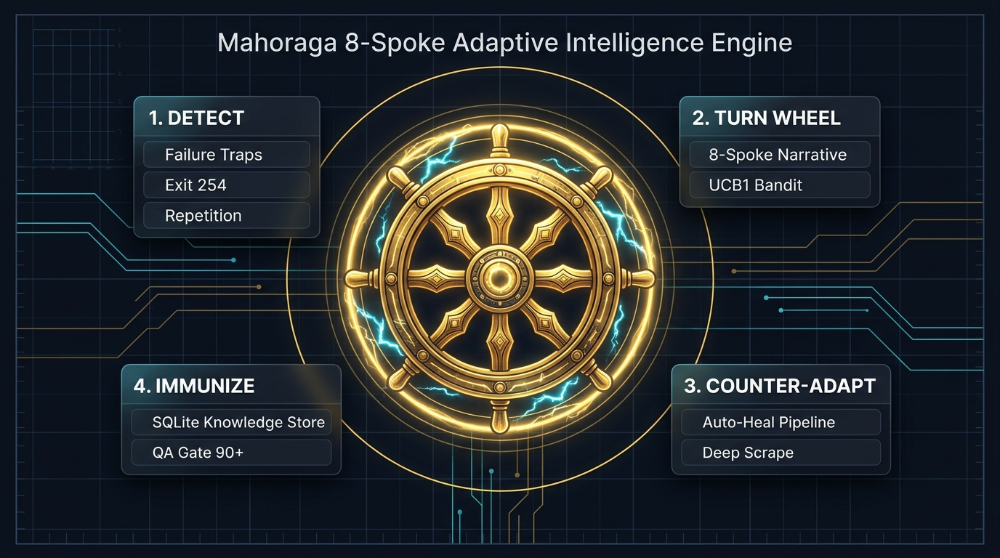
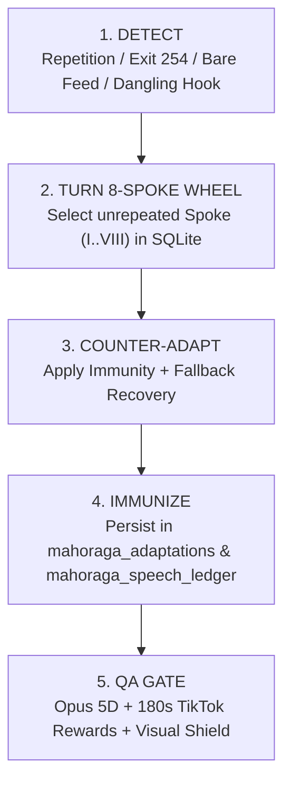

# Mahoraga 8-Spoke Adaptive Intelligence Engine

> *"Any phenomenon — repetition, truncated hooks, FFmpeg filter crashes, bare RSS headlines, or mismatched niche visuals — turns the 8-Spoke Wheel, triggers an immediate counter-adaptation, and permanently immunizes the pipeline in SQLite (`output/shorts_evolution.db`)."*

---

## 1. Architecture Overview (`src/auto_shorts/mahoraga.py`)

`MahoragaEngine` operates as an always-on adaptive layer across **narration**, **hook generation**, **visual B-roll selection**, **FFmpeg rendering**, **validation**, and **24/7 autopilot recovery**.

---

## 2. The 8 Narrative Spokes (`MAHORAGA_SPOKES`)

To prevent consecutive Shorts from sounding robotic or sharing the same opening template, `select_adaptive_spoke(niche, topic_title)` queries `mahoraga_speech_ledger` (last 4 global turns and last 3 per-niche turns) and forbids repeating recently used Spokes:

| Spoke | Roman | Name | Cadence | Strategy |
| :--- | :--- | :--- | :--- | :--- |
| `spoke_1_investigativo` | **I** | Revelação Investigativa | `misterio_bastidores` | Opens with hidden behind-the-scenes detail, connects facts, closes with analytical question. |
| `spoke_2_contrariano` | **II** | Quebra de Crença | `choque_contrariano` | Challenges common belief in the first 3 seconds and contrasts with real data. |
| `spoke_3_efeito_domino` | **III** | Efeito Dominó | `causa_consequencia` | Starts from the trigger event and traces immediate real-world chain reactions. |
| `spoke_4_raio_x` | **IV** | Raio-X Técnico | `direto_analitico` | Zero fluff: states core problem, dissects technical mechanism, delivers takeaway. |
| `spoke_5_dilema` | **V** | Dilema Estratégico | `debate_polarizado` | Pits two opposing viewpoints against each other and invites viewer stance. |
| `spoke_6_cronica` | **VI** | Crônica de Impacto | `storytelling_imersivo` | Builds a vivid scene around the turning point and closes in a seamless loop. |
| `spoke_7_radar_futuro` | **VII** | Alerta de Tendência | `previsao_acelerada` | Explains why the shift is accelerating now and what changes in the coming weeks. |
| `spoke_8_anatomia` | **VIII** | Anatomia do Segredo | `dissecacao_profunda` | Isolates the overlooked keystone detail and proves why it changes the game. |

---

## 3. Six Permanent Pipeline Immunities (`ACTIVE_IMMUNITIES`)

| Code | Target Failure | Implementation |
| :--- | :--- | :--- |
| **`IMMUNITY_SPEECH_8SPOKE`** | Single-template robotic narration & `title == summary` echo | `MahoragaEngine.compose_news_narrative()`, `immunize_spoken_script()`, multi-variant `horizon_radar.py` & `story_engine.py` |
| **`IMMUNITY_HOOK_WORD_BOUNDARY`** | Mid-word cuts (`"SOBRE O S"`), placeholders (`"4 WORDS IN CAPS"`), trailing prepositions/verbs (`"POR QUE ESCREVER SOFTWARE"`, `"CEO DA NVIDIA RENUNCIA APÓS"`) | `clean_word_boundary_hook()` integrated in `world_news.py` & `renderer.py` |
| **`IMMUNITY_VISUAL_NICHE_SHIELD`** | Brainrot gaming clips (`minecraft`, `subway`, `gta_ramp`, `beamng`) leaking into News/Tech/Anime/Finance | `_BRAINROT_GAMEPLAY_STYLES` filtered whenever `niche != "gameplay"` in `gameplay.py` & `narrator.py` |
| **`IMMUNITY_FFMPEG_3STAGE_HEAL`** | FFmpeg `exit 254` filter/zoom/overlay crashes | `render_clip()` in `renderer.py` falls back `requested -> libx264 (punch_zoom=1.0) -> clean blur_bg` and logs the phenomenon |
| **`IMMUNITY_TIKTOK_REWARDS_180S`** | 60s YouTube Shorts cap falsely rejecting `60s–180s` TikTok Creator Rewards clips | Platform-aware validator (`180s`) & Opus/YT/TT scoring calibration (`validator.py`, `re_engine.py`, `yt_algorithm.py`) |
| **`IMMUNITY_DEEP_ARTICLE_EXTRACTOR`** | Title-only feeds like Hacker News where `summary == title` | `_extract_article_lead_from_url()` scrapes `og:description`, `og:image`, and `
` paragraphs or builds domain-specific analysis |

---

## 4. SQLite Persistence (`output/shorts_evolution.db`)

- **`mahoraga_adaptations`**: `(id, created_at, phenomenon, niche, spoke_id, trigger_detail, counter_action, resolved)`
- **`mahoraga_speech_ledger`**: `(id, created_at, niche, spoke_id, topic_hash, opening_sig, reward)`

---

## 5. Production Telemetry & Endpoints

- `GET /api/mahoraga` — Returns live `mode`, `wheel_turns`, `adaptation_events`, `speech_rotations`, `active_spoke`, `immunities`, and `recent_adaptations`.
- `GET /api/status` — Includes embedded `mahoraga` telemetry so the Studio UI (`#kpi-ai-sub`) displays live wheel turns and active Roman spoke (`Mahoraga (4 giros • Raio II)`).
- Autopilot (`webapp.py`): On any cycle exception, `MahoragaEngine` records the phenomenon, advances `runs_completed` so the scheduler never gets stuck on a failing source, and counter-adapts via `produce_world_news_short()` fallback.

