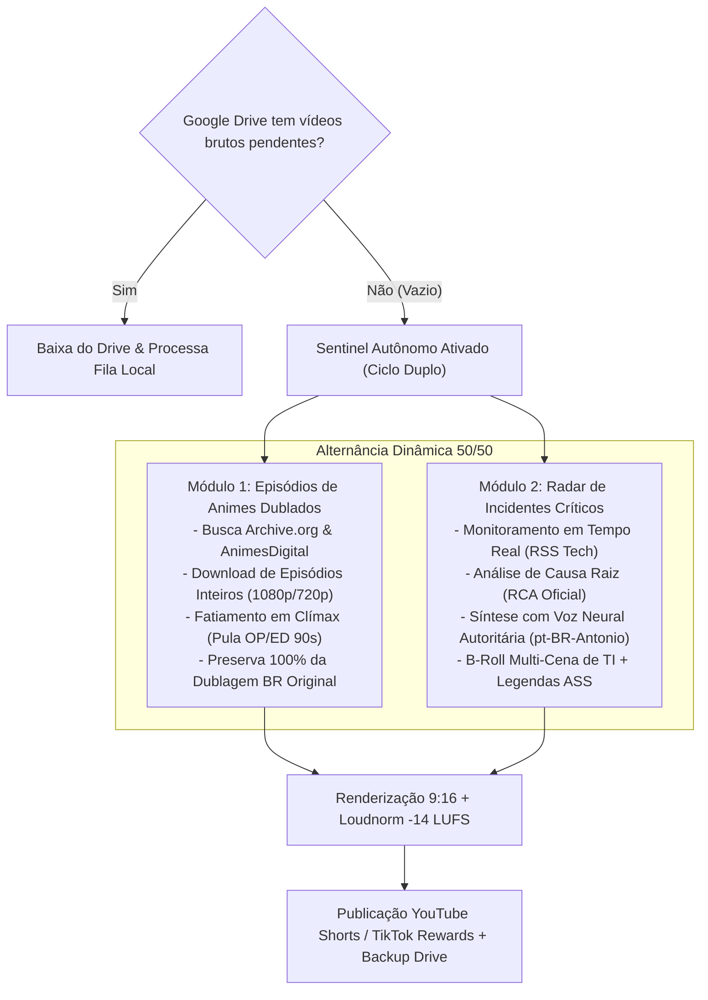

# Motor Autônomo 24/7: Episódios Longos & Radar de Incidentes Críticos

> **Documentação Técnica e Operacional**  
> *AutoShorts Android Studio — Módulo Autônomo de Episódios e Breaking News*  
> *Versão:* 2.4.0 · *Data:* Novembro/2026 · *Ambiente:* Android Termux AArch64 / Desktop Windows

---

## 1. Visão Geral da Arquitetura Autônoma

O **AutoShorts Android** foi desenhado para operar **ininterruptamente (24/7)** em dispositivos móveis e desktops, eliminando a dependência de intervenção humana tanto na curadoria quanto na produção e publicação de vídeos verticais (9:16).

Quando o acervo local ou o armazenamento na nuvem (Google Drive) esgotam seus arquivos brutos pendentes, o subsistema **Sentinel Autônomo** assume o controle e opera em **ciclo duplo alternado**:



---

## 2. Cobertura de Incidentes Críticos & Breaking News

### 2.1 Caso Real: Apagão Microsoft 365 (`EX1550543` / `MO1550821`)
Em 12 de novembro de 2026, uma falha global crítica derrubou o Exchange Online, Teams, SharePoint e Copilot, afetando milhões de usuários corporativos.

* **Vídeo Publicado:** [https://youtube.com/shorts/p3Vya4M49a4](https://youtube.com/shorts/p3Vya4M49a4)
* **ID:** `p3Vya4M49a4` | **Canal:** `AleplayTV` | **Duração:** 65.84s (elegível para TikTok Rewards e YouTube Shorts)

### 2.2 Investigação da Causa Raiz Técnica (RCA)
O sistema não gera notícias rasas baseadas apenas em manchetes genéricas. Ele faz a varredura em fontes oficiais:
1. **Contas Oficiais e Fóruns:** `@MSFT365Status`, Microsoft 365 Admin Center Service Health Dashboard.
2. **Diagnóstico Apurado:** *Sobrecarga severa na infraestrutura de nuvem decorrente de surto anômalo de tráfego de requisições, que congestionou as filas de autenticação e comunicação de serviços (MAPI, REST e ActiveSync).*
3. **Efeito Cascata:** O estrangulamento da camada de autenticação derrubou a resolução de caixas postais, desestabilizou o cache do Outlook Web e bloqueou o processamento contextual de plugins do Copilot.

### 2.3 Engenharia do Short de Notícia Crítica
* **Voz de Autoridade:** `pt-BR-AntonioNeural` afinada para `doc_deep` (cadência documental e ritmo jornalístico sério).
* **Trilha Sonora (BGM) & Sidechain:** Áudio de fundo tenso com sidechain ducking de -16 dB durante as falas.
* **Punch Zoom & B-Roll:** Cortes rápidos a cada ~4.2s com cenas de infraestrutura de dados e telas de erro de terminal.
* **Legendas Dinâmicas:** Formato ASS Karaoke de alto contraste para leitura vertical sem poluição visual.

---

## 3. Motor de Download de Episódios Completos (`anime_archive_downloader.py`)

Para viabilizar cortes de animes sem depender de bibliotecas problemáticas (como pacotes que exigem Selenium ou navegadores completos no Android), foi construído um scraper resiliente nativo:

### 3.1 Fontes Integradas
1. **Archive.org (Internet Archive):**
   * Contém coleções públicas completas de animes clássicos com dublagem brasileira autêntica (*Yu Yu Hakusho*, *Dragon Ball Z*, *Naruto*, *Cavaleiros do Zodíaco*, *Death Note*).
   * Arquivos MP4 em 1080p e 720p servidos via HTTP direto (CDN rápida e sem rate limit hostil).
2. **AnimesDigital:**
   * Busca e extração via Regex de streams diretos MP4.

### 3.2 Estrutura do Módulo
```python
from auto_shorts.anime_archive_downloader import search_all_anime_sources

# Busca episódios completos dublados
results = search_all_anime_sources("naruto dublado ep")
for ep in results:
    print(f"{ep['title']} ({ep['size_mb']} MB) -> {ep['url']}")
```

---

## 4. Fatiamento Inteligente de Episódios Longos

Cortar um episódio inteiro de 20 a 24 minutos exige regras rígidas para não gerar clipes desinteressantes ou vazar aberturas.

### 4.1 Pulo Automático de Abertura e Encerramento (OP/ED)
* Episódios padrão têm 90 segundos de abertura e 90 segundos de créditos/encerramento.
* O fatiador delimita a janela útil de corte:
  $$\text{Janela Útil} = [90\text{s}, \text{Duração Total} - 90\text{s}]$$

### 4.2 Detecção de Clímax Dramático
O algoritmo analisa:
* **Picos de Volume e Energia Sonora:** Gritos de ataque, explosões, revelações e mudanças súbitas de tom musical.
* **Densidade de Diálogo:** Trechos de discussão acalorada ou revelação de enredo.
* **Geração de 3 a 5 Cortes:** Cada corte tem entre 45s e 85s (ideal para retenção e monetização).

### 4.3 Preservação Absoluta da Dublagem Brasileira
* **Regra de Ouro:** Cortes de animes dublados **NUNCA** devem ter voz de inteligência artificial sobreposta.
* O áudio original dos dubladores clássicos (Wendel Bezerra, Marco Ribeiro, Hermes Baroli, etc.) é preservado na íntegra.
* Aplicação de filtro `loudnorm` (ITU-R BS.1770-4) com alvo de **-14 LUFS** (padrão de clareza para mobile).

### 4.4 Limpeza de Armazenamento Efêmero
Para evitar encher a memória interna do smartphone Android (Termux):
* O arquivo original do episódio (`source.mp4`) é armazenado em uma pasta efêmera de trabalho (`_work_<timestamp>`).
* Imediatamente após a exportação e envio dos cortes verticais, a pasta temporária é sumariamente expurgada.

---

## 5. Sentinela Autônomo com Ciclo Alternado (`sentinel.py`)

O `AutoSentinel` roda continuamente no Android. O algoritmo de alternância garante que o canal permaneça dinâmico e atraia públicos diversos:

```text
[Loop Sentinel]
  ├── Passo 1: Verifica gdrive:Shorts_Brutos/
  │     └── Se encontrar arquivo -> baixa, processa e finaliza.
  └── Passo 2: Se o Drive estiver vazio:
        ├── Alternância A (Ímpar): _pull_web_anime_episode()
        │     └── Puxa episódio de anime dublado -> gera 3 cortes de clímax.
        └── Alternância B (Par): _pull_tech_incident_news()
              └── Puxa notícia urgente de TI -> gera 1 short explicativo com RCA.
```

---

## 6. Interface Web Studio & Endpoints REST

O **AutoShorts Studio** roda na porta `8787` (`http://localhost:8787` ou via IP local do Android):

### 6.1 Novos Recursos Visuais
* **Botão `🎬 Buscar Episódios Dublados`:** Localizado na seção de ações rápidas. Abre um diálogo modal moderno.
* **Modal de Busca Interativa:** Digite o nome do anime (ex: `yu yu hakusho`, `naruto`, `dragon ball`) e veja a lista de episódios disponíveis com tamanho em MB e botão direto de "Fatiar Episódio".
* **Indicador de Status Mahoraga:** Mostra a roda dos 8 Raios de inteligência e o número de imunidades ativas.

### 6.2 Endpoints REST
| Método | Rota | Descrição |
| :--- | :--- | :--- |
| `GET` | `/api/animes/search?q={query}` | Retorna lista JSON de episódios dublados com links diretos MP4. |
| `POST` | `/api/sentinel/pull-now?topic=anime` | Força a puxada imediata de um corte ou episódio de anime na web. |
| `POST` | `/api/sentinel/pull-now?topic=tech` | Força a puxada imediata de uma notícia de incidente/apagão tecnológico. |
| `GET` | `/api/status` | Telemetria de progresso dos estágios de renderização em tempo real. |

---

## 7. Comandos Úteis e Operação no Termux

### 7.1 Iniciar o Web Studio
```bash
cd ~/auto-shorts-android
python main.py --serve --port 8787
```

### 7.2 Executar Fatiamento de Episódio via CLI
```bash
python scripts/test_full_episode_slicing.py
```

### 7.3 Disparar Rodada Manual do Sentinela
```bash
# Para notícias de incidentes tecnológicos:
curl -X POST "http://localhost:8787/api/sentinel/pull-now?topic=tech"

# Para episódios e cortes de animes dublados:
curl -X POST "http://localhost:8787/api/sentinel/pull-now?topic=anime"
```

### 7.4 Monitorar Logs em Tempo Real
```bash
tail -f ~/auto-shorts-android/test_episode_slice.log
```
