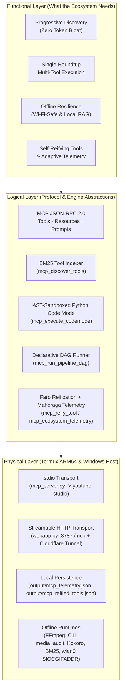

# AutoShorts Adaptive Offline MCP & Multi-Mode Code Mode Architecture

## 1. Executive Technical Verdict

The original `youtube_studio_mcp.py` exposed only 8 static YouTube-centric tools over `stdio`, had no MCP `resources` or `prompts`, lacked HTTP transport for Termux/LAN agents, and required multi-roundtrip tool calls.  
The upgraded **`autoshorts-adaptive-mcp` (`src/auto_shorts/autoshorts_mcp.py`)** unifies **stdio JSON-RPC 2.0** (`mcp_server.py`) and **Streamable HTTP (`GET/POST /mcp` on `:8787`)**, runs **100% offline** (pure Python, zero Node.js/Docker dependency), and implements **4 complementary Code Mode & Adaptive patterns** while keeping full backward compatibility with all `yt_*` tools.

---

## 2. F/L/P System Architecture Model

---

## 3. Code Mode Patterns Implemented

| Pattern | Tool | When to Use | Offline? |
| :--- | :--- | :--- | :--- |
| **1. Progressive BM25 Discovery** | `mcp_discover_tools` | Avoid loading 20+ schemas into context; query by intent/category | Yes |
| **2. AST-Sandboxed Python Code Mode** | `mcp_execute_codemode` | Chain `studio.system.health()`, `studio.vault.audit()`, `studio.autopublish.plan()` in one turn | Yes |
| **3. Declarative JSON DAG** | `mcp_run_pipeline_dag` | Deterministic multi-step execution with `$steps.<id>.<field>` resolution | Yes |
| **4. Faro Tool Reification** | `mcp_reify_tool` | Persist a proven Code Mode workflow as a permanent callable tool | Yes |
| **5. Mahoraga Telemetry** | `mcp_ecosystem_telemetry` | Inspect `p50_ms` / `p95_ms`, error rates, and offline/hybrid routing | Yes |

### Security Sandbox (`_validate_codemode_ast`)
Before `exec()`, `mcp_execute_codemode` parses the Python AST and rejects:
- Any `import` / `from ... import` outside `{json, math, re, time, datetime}`
- Any dangerous built-in call (`eval`, `exec`, `compile`, `__import__`, `open`, `getattr`, `globals`, `locals`)
- Any dunder/escape attribute access (`__class__`, `__subclasses__`, `__globals__`, `system`, `popen`)

---

## 4. MCP Resources & Prompts

- **Resources (`resources/list`, `resources/read`):**
  - `autoshorts://system/health`
  - `autoshorts://vault/audit`
  - `autoshorts://autopublish/plan`
  - `autoshorts://mahoraga/state`
  - `autoshorts://tools/catalog`
- **Prompts (`prompts/list`, `prompts/get`):**
  - `diagnose-and-heal`
  - `codemode-orchestration`

