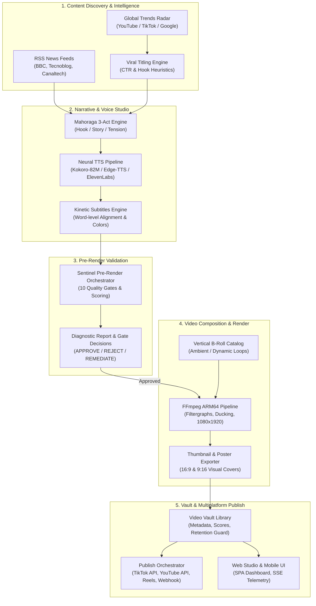

# System Architecture Overview

AutoShorts is an autonomous audiovisual production platform engineered for resource-constrained mobile environments (Android Termux ARM64) and high-throughput production workstations.

---

## 1. High-Level Subsystem Architecture

---

## 2. Core Architectural Principles

### Zero External Server Dependency
The entire pipeline runs locally on an Android device running Termux. Voice synthesis, transcript alignment, video composition, and thumbnail generation execute on-device without requiring hosted cloud servers.

### Pre-Render Quality Gating (Fail-Fast)
Rendering 1080x1920 60fps video on mobile hardware costs 30 to 60 seconds of compute and battery life. AutoShorts executes the **Sentinel Pre-Render** engine *before* invoking FFmpeg, inspecting script metrics, audio dynamics, narrative pacing, and title promises. Flawed content is rejected or repaired in milliseconds.

### Storage & Memory Guardrails
Mobile devices have hard physical limits on RAM and flash write cycles. AutoShorts enforces strict circular quotas (`STORAGE_MAX_VIDEOS`, `STORAGE_MAX_MB`), automated orphan cleanup, and streaming pipeline execution to eliminate out-of-memory kernel kills.
