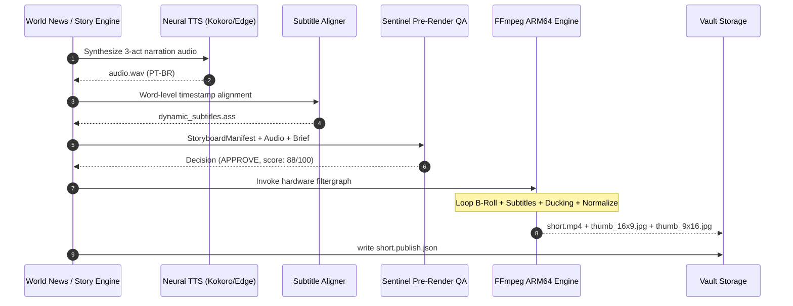

# Video Rendering & Composition Pipeline

The AutoShorts video pipeline transforms structured story data into broadcast-grade 1080x1920 vertical shorts optimized for high audience retention.

---

## 1. The 6-Stage Composition Flow

---

## 2. FFmpeg Filtergraph Specification

AutoShorts uses custom complex filtergraphs (`-filter_complex`) to achieve high visual quality on ARM64 without dropping frames:

### Visual Filtering:
- **Aspect Scaling & Cropping:** B-Roll backgrounds are scaled to fill `1080:1920` using `scale=1080:1920:force_original_aspect_ratio=increase,crop=1080:1920`.
- **Dynamic Subtitle Overlay:** Rendered using `subtitles='subtitles.ass'` with custom font stacks, high-contrast outlines, and word-by-word active karaoke highlighting.

### Audio Filtering:
- **Loudness Normalization:** Output audio is normalized to EBU R128 broadcast standards (`-16 LUFS`) for consistent playback on mobile speakers.
- **Background Music Ducking:** Sidechain compression automatically lowers ambient music volume by 12 dB when speech is detected.

---

## 3. Thumbnail & Poster Extraction

Every render automatically produces two distinct cover assets:
1. `*_thumb_9x16.jpg` (1080x1920): Vertical poster for TikTok and Instagram Reels feed grids.
2. `*_thumb_16x9.jpg` (1920x1080): Landscape cover for YouTube Studio dashboard and Web Studio library previews.
