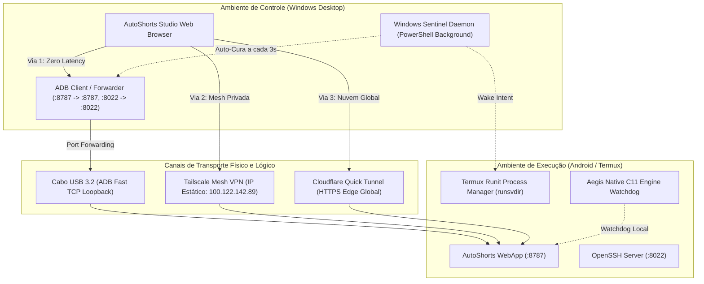

# Operação Aegis: Arquitetura de Rede Resiliente e Zero-Drop

## 1. Topologia Tripla de Acesso Contínuo
Para eliminar a dependência de endereços IP locais voláteis (DHCP) ao alternar entre redes residenciais (`192.168.0.x`) e corporativas (`192.168.10.x`), o Auto Shorts implementa uma malha com três vias de comunicação concorrentes:

---

## 2. Windows Sentinel Daemon (`autoshorts_sentinel.ps1`)
O Sentinel roda em background permanente na máquina Windows como processo oculto iniciado no boot (`shell:startup\AutoShorts_Sentinel.vbs`).

### Regras de Operação:
1. **Varredura Contínua (a cada 3s):**
   Executa `adb forward --list` para verificar a persistência dos túneis `tcp:8787` e `tcp:8022`.
2. **Re-encaminhamento Imediato:**
   Se a porta USB entrar em suspensão seletiva ou o cabo for desconectado e reconectado, o daemon restabelece as regras em menos de 1 segundo.
3. **Sonda HTTP de Saúde:**
   Efetua requisição não-bloqueante a `http://127.0.0.1:8787/api/status`.
4. **Revivificação Ativa do Termux (Wake Intent):**
   Caso a porta 8787 não responda, o daemon dispara o intent de primeiro plano via ADB:
   `adb shell am start -n com.termux/.app.TermuxActivity`
   Isso traz o Termux imediatamente de volta à execução sem intervenção manual.

---

## 3. Endereçamento e Pontos de Acesso Fixos

| Canal | Endpoint / URL | Latência Típica | Caso de Uso |
| :--- | :--- | :--- | :--- |
| **USB Local (ADB)** | `http://127.0.0.1:8787` | < 1 ms | Produção, streaming de vídeo local e depuração de alta velocidade |
| **Tailscale VPN** | `http://100.122.142.89:8787` | 15 - 35 ms | Acesso remoto seguro de qualquer rede sem expor portas públicas |
| **Cloudflare Nuvem** | `https://architects-shaft-accommodations-dad.trycloudflare.com` | 40 - 80 ms | Acesso móvel externo e monitoramento multiplataforma |
