# Atlas Omega: Engenharia Reversa Viral e Captura de Lives em Tempo Real

## 1. Visão Geral da Inteligência Criativa
O subsistema **Atlas Omega** transforma a produção tradicional em uma esteira orientada por evidências analíticas e inteligência de distribuição.

Em vez de criar vídeos às cegas, o sistema monitora fontes de alta retenção, transmissões ao vivo autorizadas e tendências de busca em tempo real para extrair os momentos de maior potencial viral.

```mermaid
flowchart LR
    Live["Transmissão ao Vivo (Twitch / YouTube / Kick)"] -->|Streamlink| Sniper["LiveStreamSniper (Buffer Circular)"]
    Sniper -->|Chunk de Áudio| Whisper["Whisper.cpp (Quantizado ARM64)"]
    Whisper -->|Transcrição com Timestamps| Radar["Viral Hook & Sentiment Scorer"]
    Radar -->|Score > 85| Cutter["Corte Cirúrgico de Cena (FFmpeg)"]
    Cutter -->|Adiciona Legenda Dinâmica + Música| Producer["AutoShorts Renderer Engine"]
    Producer -->|Validação 5D| QA["Auditor 5D (ISO-BMFF + LUFS)"]
    QA -->|Aprovado| Dispatch["Publicador Multiplataforma (CDP + Meta API)"]
```

---

## 2. O Módulo `LiveStreamSniper` (`src/auto_shorts/live_stream_sniper.py`)
Utiliza a biblioteca `streamlink` para se conectar a streams HLS/DASH diretamente via pipe Unix:
- **Buffer Circular de 120s em Disco Temporário:** Evita reter vídeo contínuo em memória RAM.
- **Detecção de Clímax:** Analisa picos de volume de áudio, densidade de fala e palavras-chave gatilho no chat ou na transcrição simultânea.
- **Janela Dinâmica de Snipe:** Extrai automaticamente fatias de 35 a 55 segundos contendo o clímax contextual completo com 2 segundos de margem inicial e final.

---

## 3. Heurística de Retenção e Gancho Inicial (Hooks)
A engenharia reversa de vídeos de alta performance demonstrou que os primeiros **1.8 segundos** determinam 80% da taxa de swipe-away nas plataformas móveis.

O motor aplica 3 regras obrigatórias de retenção:
1. **Poda Imediata de Silêncio Inicial:** O áudio começa exatamente no frame 0.05s sem "respiros" ou pausas vazias.
2. **Hook Visual Banner:** Apresenta um banner de título superior de alto contraste nos primeiros 3.5 segundos com fonte bold impactante.
3. **Música Procedural de Fundo (`src/auto_shorts/procedural_music.py`):** Mixa trilha instrumental com ducking dinâmico (-18 dB quando a voz está ativa, subindo nos silêncios naturais para manter a atenção).
