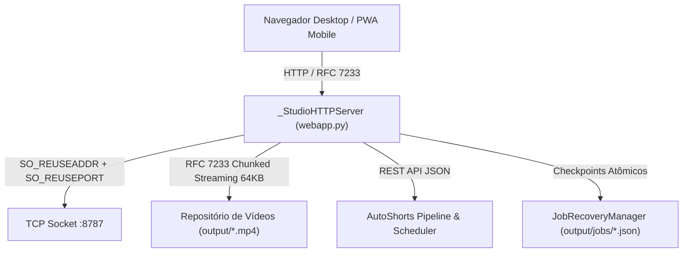

# Atlas Studio: Arquitetura do Web Studio e Streaming RFC 7233

## 1. Visão Geral da Arquitetura
O **Atlas Studio** é o centro de controle e visualização do Auto Shorts, servido diretamente pelo smartphone na porta `:8787` (`src/auto_shorts/webapp.py`).

O servidor é construído em Python padrão com arquitetura reativa, zero frameworks externos pesados (dispensando Django/Flask/Node) e integração direta com o motor de produção e auditoria.



---

## 2. Resolução do Streaming de Vídeo: RFC 7233 (206 Partial Content)

### Problema Diagnosticado:
Anteriormente, ao tentar pré-visualizar vídeos longos ou utilizar a barra de rolagem (seek) no navegador, ocorriam erros graves:
- `501 Unsupported method ('HEAD')`
- `net::ERR_CONNECTION_RESET`
- Queda de conexão devido à leitura completa do arquivo de 50MB+ em memória RAM em uma única fatia.

### Solução de Engenharia Implementada:
1. **Suporte Completo ao Verbo HTTP HEAD:**
   Permite que players de vídeo modernos inspecionem `Content-Length`, `Content-Type` e `Accept-Ranges: bytes` sem baixar o corpo da mensagem.
2. **Implementação de Streaming em Blocos de 64 KB:**
   ```python
   # Exemplo do protocolo RFC 7233 implementado em _StudioHandler
   self.send_response(206)
   self.send_header("Content-Type", "video/mp4")
   self.send_header("Content-Range", f"bytes {start}-{end}/{file_size}")
   self.send_header("Content-Length", str(content_length))
   self.send_header("Accept-Ranges", "bytes")
   self.end_headers()

   with open(video_path, "rb") as f:
       f.seek(start)
       remaining = content_length
       while remaining > 0:
           chunk_size = min(65536, remaining)
           data = f.read(chunk_size)
           if not data:
               break
           self.wfile.write(data)
           remaining -= len(data)
   ```
3. **Persistência de Sockets com `SO_REUSEPORT` e `SO_REUSEADDR`:**
   Elimina definitivamente o erro `OSError: [Errno 98] Address already in use` quando o serviço é reiniciado rapidamente pelo Runit.

---

## 3. Painel de Controle e Recursos Operacionais
- **PWA Instalável:** Totalmente responsivo para telas móveis e desktop, com cache de assets estáticos e service worker.
- **Video Vault Integrado:** Listagem em tempo real de clipes gerados com preview instantâneo, badges de nicho e status de publicação.
- **Disparo de Ciclos com 1 Clique:** Postagem imediata multi-nicho ou seleção cirúrgica de canais.
- **Telemetria de Sistema:** Indicadores visuais de pressão de memória, disco e latência.
