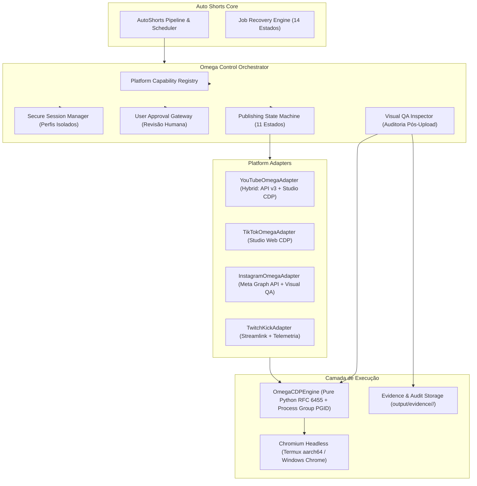

# Especificação da Arquitetura: Omega CDP Control Engine

## 1. Visão Geral e Topologia
O **Omega CDP Control Engine** é o subsistema de automação de navegadores e orquestração multiplataforma do Auto Shorts. Ele combina acesso via APIs oficiais legítimas (como Meta Graph API v19+ para Instagram Reels e YouTube Data API v3) com automação nativa via Chrome DevTools Protocol (CDP) para interfaces web autorizadas (YouTube Studio Web e TikTok Studio Web).



---

## 2. A Máquina de Estados de Publicação (11 Estados Finitos)
O fluxo de publicação é modelado de ponta a ponta para impedir uploads acidentais, reenvios duplicados e alucinações de status:

```text
CREATED -> VALIDATED -> READY_FOR_REVIEW -> APPROVED -> QUEUED ->
UPLOADING -> PROCESSING -> PUBLISHED -> VERIFIED

Estados de Exceção e Intervenção Humana:
[QUALQUER ESTADO] --- (Erro Irrecuperável) ---> FAILED
[UPLOADING / REVIEW] --- (MFA / 2FA / Login Expirado) ---> REQUIRES_HUMAN_ACTION
```

### Regras de Transição e Validação:
1. **`CREATED` -> `VALIDATED`:** O adaptador da plataforma verifica os limites de caracteres de títulos (<= 95 no YouTube Shorts), remove hashtags concorrentes (#reels no TikTok) e valida a existência física do arquivo MP4.
2. **`VALIDATED` -> `READY_FOR_REVIEW`:** A tarefa é bloqueada no `UserApprovalGateway`. Nenhuma mutação ou upload externo é efetuado sem aprovação explícita.
3. **`READY_FOR_REVIEW` -> `APPROVED`:** O operador humano (ou o agente autorizado com credencial declarada) assina a aprovação com registro em `output/reviews/approval_audit.jsonl`.
4. **`APPROVED` -> `QUEUED`:** A tarefa entra na esteira de envio.
5. **`QUEUED` -> `UPLOADING`:** O adaptador verifica previamente a existência de `remote_publish_id` para evitar duplicidade.
6. **`UPLOADING` -> `PUBLISHED`:** Confirmação técnica do upload.
7. **`PUBLISHED` -> `VERIFIED`:** O `VisualQAInspector` abre a URL pública final do vídeo, captura uma fotografia digital (screenshot) do player ao vivo, valida a correspondência do título e emite o certificado de conformidade.

---

## 3. Matriz de Comandos CLI-Anything

```bash
# Telemetria geral do Omega CDP
$ python main.py omega status --json

# Matriz de capacidades autorizadas por plataforma
$ python main.py omega capabilities --json

# Estado dos perfis de sessão e cookies
$ python main.py omega sessions --json

# Listagem de tarefas de publicação
$ python main.py omega tasks --action list --json

# Criação de nova tarefa de publicação
$ python main.py omega tasks --action create --platform youtube --video output/clip_01.mp4 --title "Inovação Tecnológica" --json

# Aprovação humana de tarefa
$ python main.py omega tasks --action approve --task-id omega_youtube_173460_a1b2c3 --operator "alessandro" --comment "Aprovado para canal oficial" --json

# Verificação visual pós-publicação
$ python main.py omega tasks --action verify --task-id omega_youtube_173460_a1b2c3 --json
```
