# Personas Multimodais Especializadas de Revisão — AUTO SHORTS SENTINEL

## 1. Estratégia de Revisão Sequencial

Para replicar o nível de exigência de uma bancada profissional de estúdio de cinema e publicidade sem esgotar a memória RAM do smartphone Android, o `MultimodalReviewPersonas` (`src/auto_shorts/sentinel_pre_render/multimodal_personas.py`) divide a auditoria em **8 personas de revisão especializadas**, executadas de maneira estritamente sequencial.

---

## 2. As 8 Personas Especializadas

```mermaid
flowchart LR
    P1["1. Creative Director<br/>(Visão & Gancho)"] --> P2["2. Script Editor<br/>(Arco & WPM)"]
    P2 --> P3["3. Visual Analyst<br/>(Semântica & B-Roll)"]
    P3 --> P4["4. Audio Director<br/>(TTS & Sincronia)"]
    P4 --> P5["5. Motion Reviewer<br/>(Safe Zones & Linhas)"]
    P5 --> P6["6. Fact-Check Editor<br/>(Promessas Numéricas)"]
    P6 --> P7["7. Platform Specialist<br/>(Shorts/Reels UX)"]
    P7 --> P8["8. QA Orchestrator<br/>(Veredito Final)"]
```

### 1. Creative Director
- Foco: Visão artística, potência do gancho inicial (primeiros 3 segundos), probabilidade de prender a atenção e valor de entretenimento.
- Peso: 15%

### 2. Script Editor
- Foco: Clareza da mensagem, cadência (WPM), transições de frases, gramática e eliminação de clichês de IA (anti-slop).
- Peso: 15%

### 3. Visual Semantic Analyst
- Foco: Relevância de cada imagem/vídeo para o texto que está sendo falado. Bloqueia contradições visuais e repetições cansativas.
- Peso: 15%

### 4. Audio Director
- Foco: Fluidez da locução, pausas para respiração natural, ausência de cortes secos e volume de trilha de fundo adequado.
- Peso: 10%

### 5. Motion Design Reviewer
- Foco: Conformidade de enquadramento 9:16, posicionamento das legendas dentro das safe zones e tamanho de fonte legível em telas pequenas.
- Peso: 15%

### 6. Fact-Check Editor
- Foco: Verificação de reivindicações objetivas. Se o título prometeu "5 técnicas", garante que exatamente 5 técnicas distintas foram entregues.
- Peso: 10%

### 7. Platform Specialist
- Foco: Adequação específica às diretrizes do YouTube Shorts, TikTok ou Instagram Reels. Duração ideal (entre 20 e 55 segundos).
- Peso: 10%

### 8. QA Orchestrator
- Foco: Consolidação matemática de todas as notas, auditoria cruzada de discrepâncias e cálculo do veredito final (PASS, REQUIRES_REVIEW ou FAIL).
- Peso: 10%
