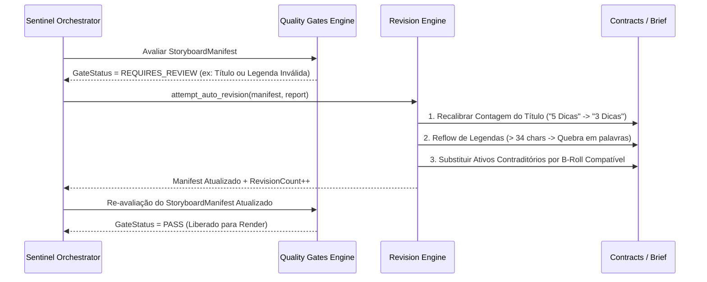

# Motor de Autocorreção Guiada por Evidências — AUTO SHORTS SENTINEL

## 1. Princípio do Ciclo Fechado de Reparo

O `EvidenceGuidedRevisionEngine` (`src/auto_shorts/sentinel_pre_render/revision_engine.py`) não se limita a emitir avisos ou relatórios de erro. Ele opera como um agente corretivo que aplica transformações cirúrgicas nos contratos de conteúdo com base nas evidências geradas pelas personas e pelos Quality Gates.

---

## 2. Regras de Reparo Automático

### A. Recalibração de Contagem do Título
Quando o Gate 01 detecta que o título prometeu *N* itens mas o roteiro só possui *K* itens (onde $K < N$):
- O motor localiza o número $N$ no título e substitui pelo valor real $K$.
- Exemplo: `"5 Truques Secretos de Edição"` converte-se em `"3 Truques Secretos de Edição"`.

### B. Reflow de Legendas que Estouram a Safe Zone
Quando o Gate 05 detecta que uma frase de legenda ultrapassa 34 caracteres:
- O motor segmenta a frase nos limites de palavras (`word boundary`), gerando duas ou mais linhas compactas (ex: 2 linhas de 22 caracteres) sem cortar palavras ao meio.
- Garante conformidade imediata com a zona de segurança do TikTok e YouTube Shorts.

### C. Substituição de Mídia Conflitante
Quando o Gate 04 detecta uma contradição visual:
- O motor consulta os ativos disponíveis em `assets/video_vault/` que possuam tags associadas ao tema real do roteiro.
- O caminho do ativo (`asset_path`) no `SceneContract` é atualizado cirurgicamente para a nova mídia compatível.

---

## 3. Garantias de Convergência

- **Limite de Iterações:** Máximo de 3 tentativas por projeto. Se o projeto não convergir para `PASS` após 3 iterações, a produção é pausada e enviada para intervenção humana, garantindo que o sistema nunca entre em loop infinito de processamento.
